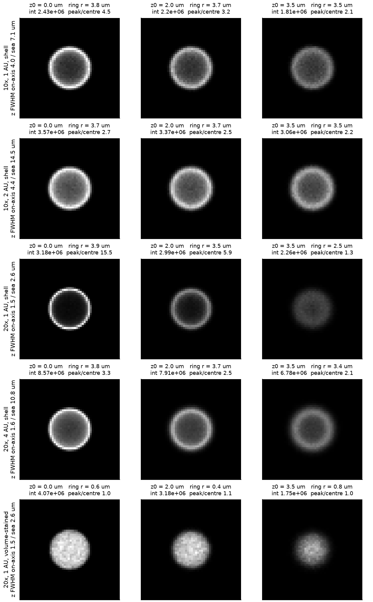
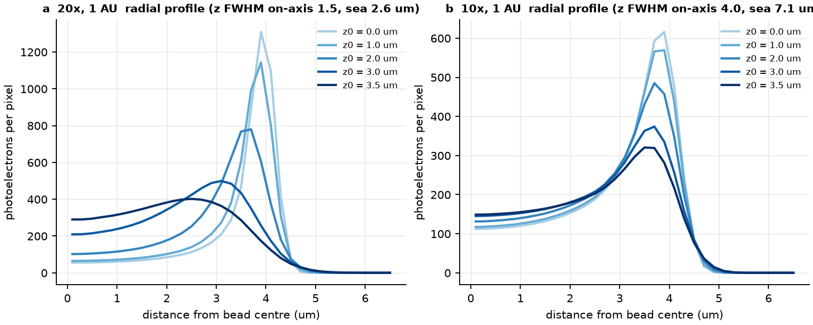
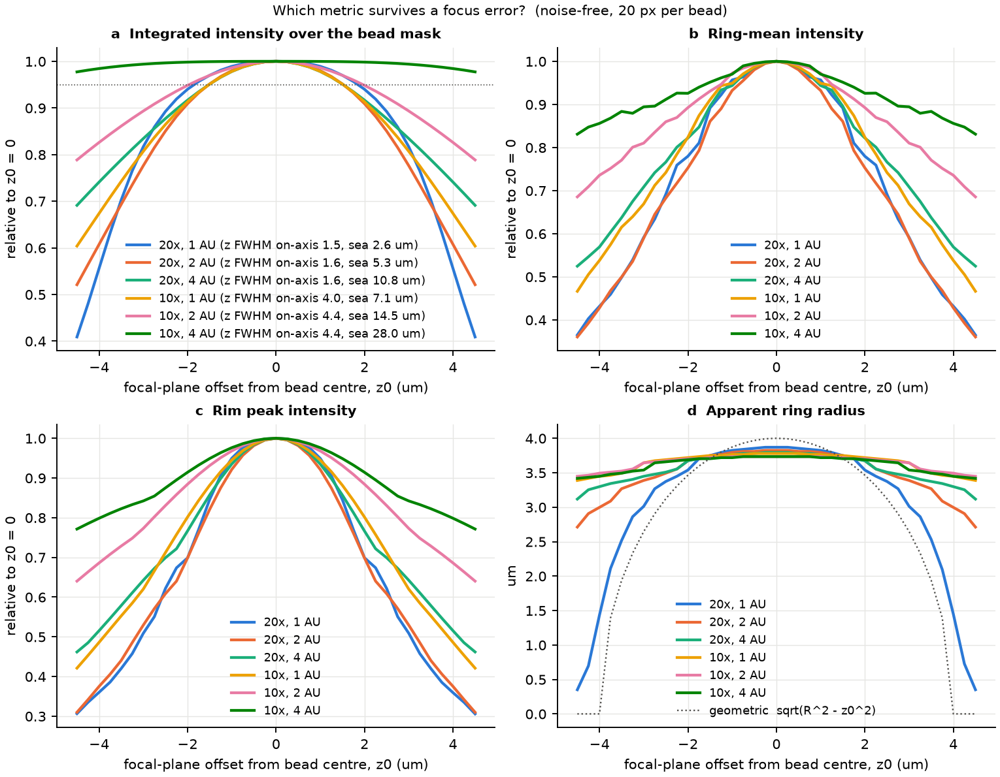
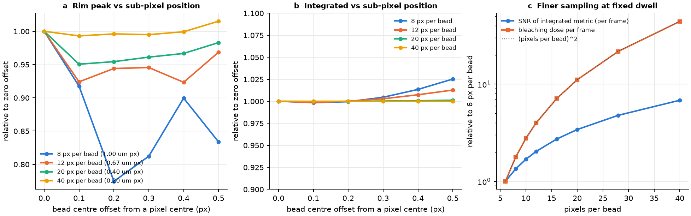
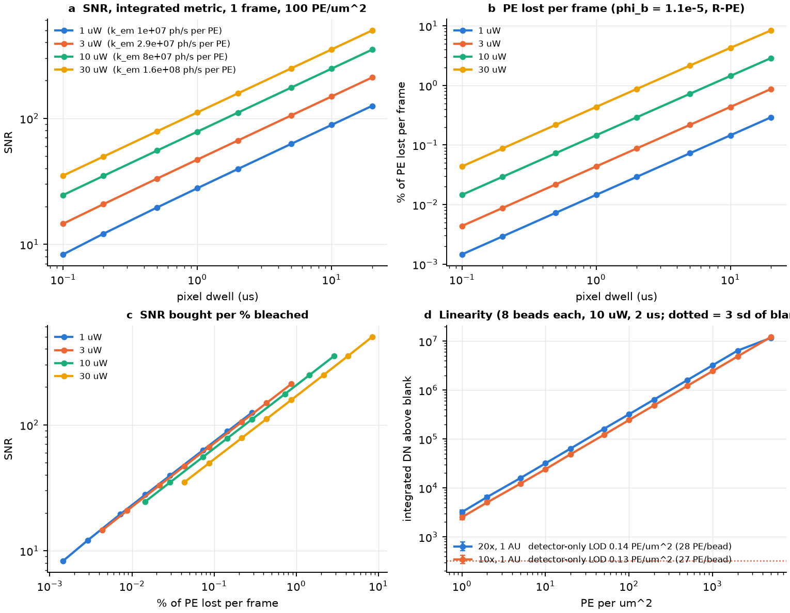
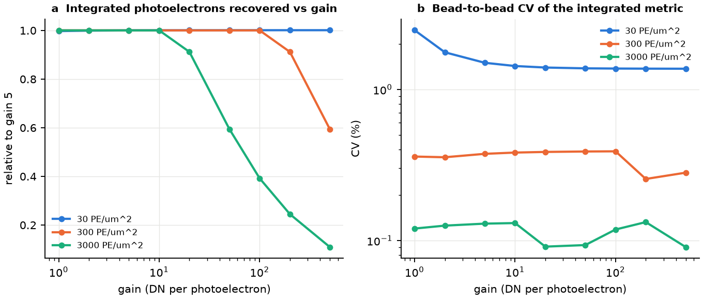
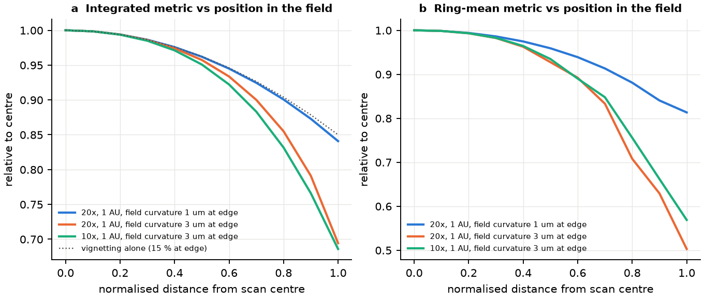
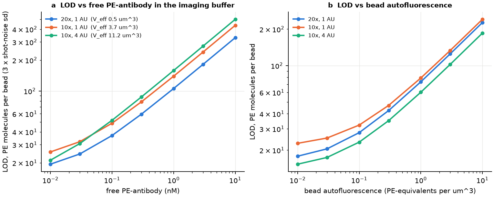
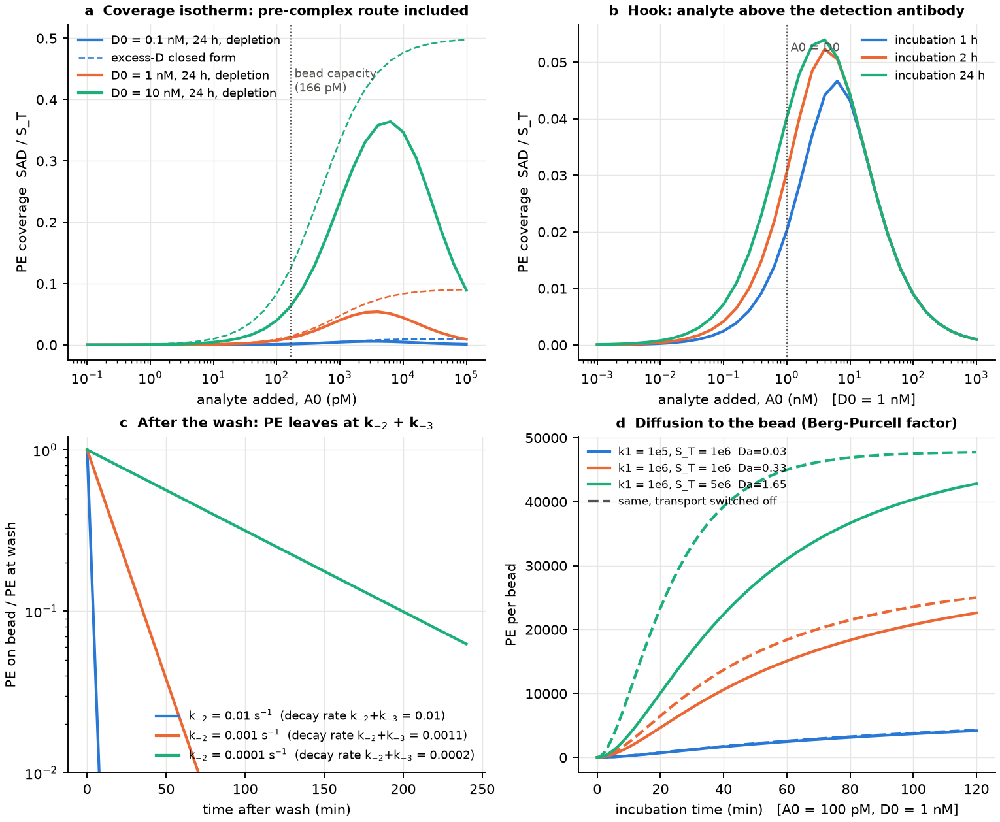

# PE sandwich beads on the Nikon AX R — binding model, shell image simulation and measurement strategy

*McGhee Lab · 2026-10-24 · deep-research report (15 sources, 104 claims, each checked by three independent verifiers;
98 confirmed by at least two, 1 refuted) plus an independent simulator in [bead_confocal_sim/](bead_confocal_sim/).
The experiments that pin the model to the real instrument are in
[PE_bead_confocal_experiments.md](PE_bead_confocal_experiments.md).*

> **Bottom line.** Measure each bead by its **background-subtracted integrated intensity**, never by its ring or rim
> peak. For a uniform shell the integrated signal is 2πRσ∫H(z − z₀)dz, so it is the only metric that is unbiased by
> sub-pixel position and tolerant of focus. Use **10x with the pinhole open** for washed, high-throughput reads
> (flat to about ±4 µm of focus). Use **20x at 1 AU** for no-wash or the lowest signals (flat to about ±1.75 µm,
> smallest background volume). Keep the 561 nm power at the sample to **≈3 µW (20x) or ≈8 µW (10x)** so PE stays
> linear, take one frame per field, and focus in transmitted light. On the binding side, the one-step format's
> equilibrium signal is (fraction of sites holding analyte) × (fraction of analyte carrying a detection antibody).
> The detection antibody's K_D sets the ceiling, and the hook starts once analyte exceeds the detection antibody.
> After the wash, PE decays as one exponential at k₋₂ + k₋₃, so the two off-rates need a perturbation experiment to
> separate.

## Executive summary

**Binding (Part A)**
- With independent epitopes, PE coverage factors exactly into θ_cap × g: the captured fraction times the labelled
  fraction. The equilibrium is the same whether PE arrives as a solution pre-complex or is added on the surface; the
  route only changes the kinetics. Two decoupled quadratics give it in closed form.
- **Ceiling:** S_T·D₀/(K_D2 + D₀). **Hook:** above A_T ≈ max(S_T + K_D1, D₀ + K_D2) the signal falls as S_T·D₀/A_T.
  **Depletion:** with many beads, the signal is linear in A_T, inversely proportional to bead number, and nearly
  independent of K_D1.
- At the low end, depletion makes the signal more sensitive to **k₋₂** (log-sensitivity ≈ −0.5) than to **k₋₁** (≈ −0.06).
- **After the wash:** PE(t) = PE₀·e^−(k₋₂+k₋₃)t, a single exponential, because the analyte-only species is dark.
  k₋₁ and k₋₂ cannot be separated from PE data alone. A relabel pulse, a detection-antibody clamp or a
  directly labelled analyte separates them. With k₋₂ ≈ 10⁻⁴–10⁻³ s⁻¹, 3–23 % of the PE is gone 5 min after the wash.
  The wash-to-image time must therefore be fixed, or the read done without a wash.
- **Transport:** an 8 µm bead is in mixed control (Damköhler number 0.05–3). Settling matters more than that: settled
  beads harvest analyte only from a thin layer. **Keep beads suspended during incubation.**

**Optics (Parts B and C)**
- A thin shell projects as σR/√(R² − ρ²) per hemisphere, so the rim is about 5–6× brighter than a flat sheet of the
  same density.
  - At 20x/1 AU it images as a ring with a dark centre (peak/centre ≈ 15 in the simulator, > 100 with a Gaussian
    section; experiment 5 decides).
  - At 10x it images as a filled disc with a bright rim (peak/centre ≈ 3–5).
  - A volume-stained bead is a flat disc.
  - The ring radius stays near R until the focus is ≥ 2.5 µm off.
- **Two section widths matter.** The on-axis point width sets the ring; the plane-integrated width sets the
  integrated metric. At 1 AU they are 1.5/2.6 µm (20x/0.75) and 4.0/7.1 µm (10x). With the pinhole open the plane
  width grows to 11 µm (20x) or 28 µm (10x).
- **The integrated metric is focus-tolerant in two regimes:** a section much thinner than the bead (a plateau of
  ±1.5–1.75 µm at 20x 1 AU) and one much thicker (±4.5 µm at 10x 4 AU). The worst case is a section about as thick
  as the bead.
- **Photophysics:** R-PE saturates at ≈5×10²² photons cm⁻² s⁻¹ (≈19 kW/cm² at 561 nm). It is destroyed after
  ≈9×10⁴ absorptions (φ = 1.1×10⁻⁵) and has a reversible millisecond dark state. A single-plane read collects
  ≈275 photons per PE over its lifetime at 20x, so a 5 % bleach budget is ≈14 photons per PE.
- **Detection limit:** the detector-only LOD is ≈15–20 PE per bead. In practice the floor will be non-specific
  binding and bead-to-bead site variation. Free PE-antibody raises the LOD to ≈110–160 PE per bead at 1 nM.

## Part A — PE surface coverage on an 8 µm sandwich bead as a function of analyte concentration

### A.0 Main results

1. **If the epitopes are independent, the signal factors exactly into two terms.** Assume the detection antibody binds analyte equally well whether the analyte is captured or free ($K_2=K_4$), and capture works equally well whether the analyte is labelled or not ($K_3=K_1$). Then the PE-bearing fraction of capture sites is
   $$\theta_{PE}(t)=\theta_{cap}(t)\cdot g(t)$$
   - $\theta_{cap}$ is the fraction of sites holding analyte, labelled or not.
   - $g$ is the fraction of analyte, anywhere, that carries a detection antibody.

   This holds at equilibrium and also at every time point, provided $k_3=k_1$, $k_{-3}=k_{-1}$, $k_2=k_4$ and $k_{-2}=k_{-4}$. It holds even when the detection antibody is depleted. A consequence is that, at equilibrium, it does not matter whether the PE arrives as a solution pre-complex or is added on the surface. The route matters only for kinetics.
2. **Equilibrium reduces to two separate quadratics.** One is in capture (Chang's depletion quadratic [S1]); the other is in detection-antibody depletion. The one-step **hook** follows automatically:
   - The maximum signal is about $\min(S_T,D_T)$.
   - The fall starts at $A_T\approx\max(S_T+K_1,\;D_T+K_2)$.
   - Beyond that, $SAD\approx S_T D_T/(A_T+K_2)$.
3. **An 8 µm bead is in mixed transport/reaction control.** The diffusion-limited rate per bead is $k_D=4\pi RD\approx 0.9$–$2.6\times10^{12}\ \mathrm{M^{-1}s^{-1}}$. With $10^6$–$3\times10^6$ active sites and $k_{on}=10^5$–$10^6$, the Damköhler number is about 0.05–3, highest for the large analyte–PE-antibody complex. This contrasts with 2.5 µm beads, where diffusion is non-limiting [S1, S2, S8, S14].
4. **Most practical incubations never reach equilibrium.** Capture runs on the bulk clock $k_{cap}=c_b k_{bead}$, which is set by the **number of beads**. In the reference case below, 1 h captures only about 35% of the analyte, and the signal roughly doubles between 1 h and 3 h.
5. **After the wash, the PE-only signal is structurally single-exponential.** It decays at rate $k_{-2}+k_{-3}$, which equals $k_{-2}+k_{-1}$ under independence. **The two off-rates cannot be told apart from a PE time series alone.** Separating them needs a perturbation: a relabel pulse, a detection-antibody clamp, or a directly labelled analyte (§A.4).
6. **PE surface density has a steric ceiling.** It is about $0.35$–$1.2\times10^6$ PE per bead (about 1,700–5,800 PE/µm²). At the literature capture density ($\approx2.8\times10^6$ IgG per 8 µm bead [S1, extrapolated]), PE per bead at saturation is therefore at most about 0.1–0.4 of the capture sites. At pM analyte, the bead carries only about 1–10 PE/µm².

---

### A.1 Species, reactions and rate constants

#### Species

| Symbol | Meaning | Where |
|---|---|---|
| $S$ | free functional capture paratope (capture IgG on bead) | surface |
| $A$ | free analyte (single capture epitope, single detection epitope, assumed) | solution |
| $D$ | free PE-labelled detection antibody (PE-IgG conjugate, $n_{PE}$ PE per IgG, assumed $\approx1$) | solution |
| $AD$ | analyte–detection-antibody pre-complex | solution |
| $SA$ | captured, unlabelled analyte (dark) | surface |
| $SAD$ | captured, labelled analyte (**the only species that emits**) | surface |
| $SD$ | detection antibody bound non-specifically to bead/capture IgG (background) | surface |

**Per-bead quantities:**
- $N_S$ is the number of active capture sites per bead.
- The bead surface area is $A_b=4\pi R^2=201\ \mu$m² for $R=4\ \mu$m, so the site density is $\Gamma_S=N_S/A_b$.

**Bulk-equivalent quantities** for $n_b$ beads in volume $V$:
$$c_b=\frac{n_b}{N_AV},\qquad S_T=c_bN_S,\qquad \phi=\frac{n_b\tfrac43\pi R^3}{V}$$

Surface species are carried as bulk-equivalent molar concentrations, e.g. $[SAD]=c_b\,n_{SAD}$, with $n_{SAD}$ the number per bead.

*Reference case, used throughout (an assumption, not lab data):* $n_b=10^4$ beads in 50 µL. This gives:
- $c_b=3.3\times10^{-16}$ M
- $\phi=5.4\times10^{-5}$
- mean inter-bead spacing ≈ 171 µm
- with $N_S=10^6$ active sites, $S_T=0.33$ nM

#### Reactions

$$
\begin{aligned}
&(1)\quad A+S \underset{k_{-1}}{\overset{k_1}{\rightleftharpoons}} SA &&\text{capture of free analyte}\\
&(2)\quad D+SA \underset{k_{-2}}{\overset{k_2}{\rightleftharpoons}} SAD &&\text{labelling on the surface}\\
&(3)\quad AD+S \underset{k_{-3}}{\overset{k_3}{\rightleftharpoons}} SAD &&\text{capture of the pre-complex}\\
&(4)\quad A+D \underset{k_{-4}}{\overset{k_4}{\rightleftharpoons}} AD &&\text{pre-complexing in solution}\\
&(5)\quad D+S \underset{k_{-5}}{\overset{k_5}{\rightleftharpoons}} SD &&\text{non-specific background (optional)}
\end{aligned}
$$

#### The detailed-balance constraint

Reactions 1–4 form a thermodynamic cycle, so the four dissociation constants are not independent:
$$K_1K_2=K_3K_4,\qquad K_i=k_{-i}/k_i$$
Any parameter set that violates this produces a spurious steady-state cycle flux.

#### Usual simplifying assumptions (all of them assumptions)

| Assumption | Physical meaning | When it fails |
|---|---|---|
| $k_4=k_2,\ k_{-4}=k_{-2}$ | the detection epitope is equally accessible on free and captured analyte | Surface crowding, or the capture paratope occluding a nearby epitope (smaller $k_2$). Avidity: a bivalent PE-IgG bridging two neighbouring SA lowers the effective $k_{-2}$ on the surface but not in solution. Crowding becomes plausible once captured analytes lie within the ~10–15 nm IgG arm span, i.e. at high $\theta_{cap}$ with the ~8.5 nm site spacing of [S1]. |
| $k_3=k_1,\ k_{-3}=k_{-1}$ | capture does not care whether the analyte is labelled | Intrinsic $k_3$ may be reduced by sterics: the ~390 kDa complex must reach a paratope on a crowded IgG layer. The **transport-limited** $k_3$ is smaller because $D_{AD}\approx 3\times10^{-7}$ vs $D_A\approx 6$–$9\times10^{-7}$ cm²/s (§A.3). Analyte held bivalently by two capture IgGs gives a smaller effective $k_{-1}$ and $k_{-3}$ (Chang argues an effective $K_D<10^{-11}$ M [S1]). |
| one detection epitope per analyte | 1 PE-IgG per analyte | Multi-epitope or repeating-epitope analytes (dimers, ferritin-like) carry several detection antibodies [S7]. A bivalent detection IgG can also hold two analytes in solution ($A_2D$) at high $A_T$. |
| $n_{PE}=1$ | one PE per detection IgG | Commercial PE conjugates are heterogeneous (mixtures of 0, 1 and 2 PE per IgG, plus free PE). Calibrate PE per D separately. |

If only the equilibrium constants are equal ($K_2=K_4$, which forces $K_3=K_1$ by the cycle) and the rate constants differ, the **equilibrium** factorisation in §A.2 still holds, but the kinetic factorisation does not.

---

### A.2 Incubation model

#### A.2.1 ODE system (mass action, finite sites, finite volume, transport-corrected)

Write $S=S_T-[SA]-[SAD]-[SD]$. The transport correction factors are
$$\Gamma_i=\frac{1}{1+\mathrm{Da}_i}$$
with $\mathrm{Da}_1=k_1n_S/k_{D,A}$, $\mathrm{Da}_3=k_3n_S/k_{D,AD}$, $\mathrm{Da}_2=k_2n_{SA}/k_{D,D}$ and $\mathrm{Da}_5=k_5n_S/k_{D,D}$. Here $n_S$ and $n_{SA}$ are the current numbers per bead, so each $\Gamma$ changes over time (§A.3). Each surface reaction's forward **and** reverse constants are divided by the same $1+\mathrm{Da}$ [S8, S14].

$$
\begin{aligned}
\frac{d[A]}{dt}&=-\Gamma_1\big(k_1[A]S-k_{-1}[SA]\big)-\big(k_4[A][D]-k_{-4}[AD]\big)\\
\frac{d[D]}{dt}&=-\Gamma_2\big(k_2[D][SA]-k_{-2}[SAD]\big)-\big(k_4[A][D]-k_{-4}[AD]\big)-\Gamma_5\big(k_5[D]S-k_{-5}[SD]\big)\\
\frac{d[AD]}{dt}&=\big(k_4[A][D]-k_{-4}[AD]\big)-\Gamma_3\big(k_3[AD]S-k_{-3}[SAD]\big)\\
\frac{d[SA]}{dt}&=\Gamma_1\big(k_1[A]S-k_{-1}[SA]\big)-\Gamma_2\big(k_2[D][SA]-k_{-2}[SAD]\big)\\
\frac{d[SAD]}{dt}&=\Gamma_2\big(k_2[D][SA]-k_{-2}[SAD]\big)+\Gamma_3\big(k_3[AD]S-k_{-3}[SAD]\big)\\
\frac{d[SD]}{dt}&=\Gamma_5\big(k_5[D]S-k_{-5}[SD]\big)
\end{aligned}
$$

**Conservation:**
- $A_T=[A]+[AD]+[SA]+[SAD]$
- $D_T=[D]+[AD]+[SAD]+[SD]$
- $S_T=S+[SA]+[SAD]+[SD]$

**Initial conditions (one-step format):** $[A]=A_T$, $[D]=D_T$, all others 0. A pre-mix variant starts from $[AD](0)$ at the solution equilibrium.

**Observable:** PE per bead $N_{PE}=n_{PE}\,([SAD]+[SD])/c_b$.

**Validity:**
- Well-mixed bulk.
- Dilute beads ($\phi\ll1$, so no diffusive interaction between beads).
- Quasi-steady diffusion around each bead, i.e. $t\gg R^2/D\approx0.2$–$0.5$ s (§A.3).

#### A.2.2 Non-dimensional form

**Scaling:** concentrations by $S_T$, time by the capture clock $\tau=k_1S_Tt$.

**Dimensionless variables:**
- $a=[A]/S_T$, $d=[D]/S_T$, $c=[AD]/S_T$
- $\theta_A=[SA]/S_T$, $\theta_{PE}=[SAD]/S_T$
- $s=1-\theta_A-\theta_{PE}$ (with $SD$ neglected)

**Dimensionless parameters:**
- $\kappa_i=K_i/S_T$, subject to $\kappa_1\kappa_2=\kappa_3\kappa_4$
- $\lambda_i=k_i/k_1$

$$
\begin{aligned}
a'&=-\Gamma_1(as-\kappa_1\theta_A)-\lambda_4(ad-\kappa_4c)\\
d'&=-\lambda_2\Gamma_2(d\theta_A-\kappa_2\theta_{PE})-\lambda_4(ad-\kappa_4c)\\
c'&=\lambda_4(ad-\kappa_4c)-\lambda_3\Gamma_3(cs-\kappa_3\theta_{PE})\\
\theta_A'&=\Gamma_1(as-\kappa_1\theta_A)-\lambda_2\Gamma_2(d\theta_A-\kappa_2\theta_{PE})\\
\theta_{PE}'&=\lambda_2\Gamma_2(d\theta_A-\kappa_2\theta_{PE})+\lambda_3\Gamma_3(cs-\kappa_3\theta_{PE})
\end{aligned}
$$

with $a(0)=\alpha\equiv A_T/S_T$ and $d(0)=\delta\equiv D_T/S_T$.

**Control groups:**

| Group | Meaning |
|---|---|
| $\alpha$ | analyte-to-capture-capacity ratio |
| $\delta$ | label-to-capacity ratio |
| $\kappa_1$ | capture affinity vs capacity; $\kappa_1\ll1$ is the depletion ("mass-sensing") regime |
| $\kappa_2$ | label affinity |
| $\lambda_2,\lambda_4$ | labelling speed vs capture speed |
| $\mathrm{Da}_i$ | transport |
| $\tau_{inc}=k_1S_Tt_{inc}$ | incubation length on the capture clock |
| $\omega_i=k_{-i}/(k_1S_T)$ | off-rates on the capture clock |

#### A.2.3 Equilibrium

Under independence ($K_2=K_4$, $K_3=K_1$) and with background neglected:
$$[SA]=\frac{S[A]}{K_1},\quad [AD]=\frac{[A][D]}{K_2},\quad [SAD]=\frac{S[A][D]}{K_1K_2}$$
Define the total free analyte $A_f=[A]+[AD]=[A](1+[D]/K_2)$. Then
$$\boxed{\theta_{PE}^{eq}=\underbrace{\frac{B}{S_T}}_{\theta_{cap}}\cdot\underbrace{\frac{D_f}{K_2+D_f}}_{f_D}}$$

The two factors come from **separate** quadratics.

**Capture**, with $B=[SA]+[SAD]$ (this is Chang's equation [S1]):
$$B^2-(K_1+S_T+A_T)B+S_TA_T=0,\qquad B=\tfrac12\Big[(K_1+S_T+A_T)-\sqrt{(K_1+S_T+A_T)^2-4S_TA_T}\Big]$$

**Label depletion.** $D$ conservation gives $D_T=D_f+A_T\frac{D_f}{K_2+D_f}$ exactly, because $A_f+B=A_T$. So
$$D_f^2+(K_2+A_T-D_T)D_f-K_2D_T=0,\qquad D_f=\tfrac12\Big[-(K_2+A_T-D_T)+\sqrt{(K_2+A_T-D_T)^2+4K_2D_T}\Big]$$

**Key consequences:**
- The equilibrium signal is **route-independent** (pre-complex or surface labelling).
- It depends on the label only through $A_T$, $D_T$ and $K_2$.

If $K_2\neq K_4$, the two quadratics couple. Solve $\{A_T,D_T\}$ conservation numerically (a 2-D root find); the factorisation is lost.

**Practical closed forms:**

| Limit | Condition | $N_{PE}$ per bead |
|---|---|---|
| Excess label | $D_T\gg A_T$, $D_T\gg S_T$ | $N_S\,\theta_{cap}\,\frac{D_T}{K_2+D_T}$ (a constant label factor times capture) |
| Ambient analyte (no depletion) | $S_T\ll K_1+A_T$ | $\theta_{cap}=A_T/(K_1+A_T)$: a Langmuir curve, i.e. a 4PL with Hill slope 1 and EC₅₀ $=K_1$; independent of bead number |
| Mass-sensing (depletion) | $S_T\gg K_1$, $A_T<S_T$ | $B\approx A_T$, so $N_{PE}\approx f_D\,A_T N_AV/n_b$: linear in $A_T$, **inversely proportional to bead number**, nearly independent of $K_1$ |
| Fast solution pre-complex | $k_4D_T\gg k_{cap}$ | Equilibrium unchanged. Kinetically, nearly all analyte arrives as $AD$, so capture runs at $k_3\Gamma_3$ (slower diffusion) instead of $k_1\Gamma_1$ |
| Hook | $A_T\gg D_T+K_2$ and $A_T\gg S_T+K_1$ | $f_D\approx D_T/(A_T+K_2)$, $\theta_{cap}\to1$, so $N_{PE}\approx N_S D_T/(A_T+K_2)\propto1/A_T$ |

**When a 4PL fit is adequate:** the Langmuir form is a 4PL with slope 1 plus a background floor. The 4PL is acceptable only in the ambient, excess-label, single-affinity regime. It fails in four situations:
1. **Depletion:** a linear rise then an abrupt plateau, giving an apparent Hill slope >1.
2. **Affinity heterogeneity** of polyclonal or randomly oriented capture antibody: apparent slope <1 [S13].
3. **Hook:** non-monotonic.
4. **Non-equilibrium readout:** the apparent EC₅₀ drifts with $t_{inc}$ and $n_b$.

Use the mechanistic model, or a 5PL plus an explicit hook term, for curve fitting.

**Hook / prozone condition (equilibrium, sharp-binding limit $K\to0$):**
$$SAD\approx\min(A_T,S_T)\cdot\min\!\Big(1,\frac{D_T}{A_T}\Big)$$
- **Rise:** linear up to $\min(S_T,D_T)$.
- **Plateau:** at $\min(S_T,D_T)$.
- **Fall:** as $S_TD_T/A_T$ above $A_{hook}\approx\max(S_T+K_1,\,D_T+K_2)$.

This reproduces the observations that the one-step hook occurs regardless of analyte [S7]; that raising capture capacity ($S_T$, i.e. more beads or more sites per bead) moves it higher [S7]; and that the label concentration matters [S7].

It also reconciles two sources. The "ideal" homogeneous two-site model has no hook [S13] because that is a washed two-step assay with no free analyte present during labelling. The one-step format has free analyte by construction.

**Kinetic hook.** At finite time a hook appears earlier when $k_4D_T t\gtrsim1$ while $\theta_{cap}$ saturates quickly, because solution analyte competes for the label.

**Sensitivity of equilibrium SAD to the off-rates** (exact, verified numerically against finite differences). Since $K_1=k_{-1}/k_1$:
$$\frac{\partial\ln SAD}{\partial\ln k_{-1}}=-\frac{K_1}{\sqrt{(K_1+S_T+A_T)^2-4S_TA_T}}$$
- No depletion: this tends to $-(1-\theta_{cap})$.
- Deep depletion: it tends to $\approx-K_1/(S_T-A_T)\approx0$.

$$\frac{\partial\ln SAD}{\partial\ln k_{-2}}=\frac{K_2}{K_2+D_f}\left(\frac{K_2D_f'}{D_f}-1\right),\qquad D_f'=\frac{D_T-D_f}{\sqrt{(K_2+A_T-D_T)^2+4K_2D_T}}$$
- Excess label: this tends to $-(1-f_D)$.
- Deep hook: it tends to $-K_2/(A_T+K_2)\approx0$ (stoichiometric).

In the reference case:
- the $k_{-1}$ sensitivity is about −0.06 (1 pM) and −0.03 (1 nM);
- the $k_{-2}$ sensitivity is about −0.52 (1 pM) and −0.20 (10 nM).

**At the low end the signal is controlled by the detection antibody's $K_2$, not by the capture $K_1$**, because the beads deplete the analyte. To cut the $k_{-2}$ sensitivity, raise $D_T$ well above $K_2$, at the cost of more non-specific background [S1].

#### A.2.4 Closed-form kinetics at low analyte ($A_T\ll S_T,D_T$)

The system becomes a linear four-state chain for each analyte molecule. Under independence (with $\Gamma_3=\Gamma_1$), capture and labelling are **independent two-state processes**:
$$P_{cap}(t)=\frac{k_{cap}}{k_{cap}+k_{-1}^e}\Big(1-e^{-(k_{cap}+k_{-1}^e)t}\Big),\qquad g(t)=\frac{k_2D_T}{k_2D_T+k_{-2}}\Big(1-e^{-(k_2D_T+k_{-2})t}\Big)$$
$$N_{PE}(t)=n_{PE}\,\frac{A_TN_AV}{n_b}\,P_{cap}(t)\,g(t),\qquad k_{cap}=c_b\,k_{bead}\ (\text{§A.3})$$

**Check against [S1].** The PSA detection antibody has $k_2=3.9\times10^5$ and $k_{-2}=8.6\times10^{-4}$, used at $D_T=1$ nM. The formula gives $g(1000\,\mathrm s)=0.31\times(1-e^{-1.25})=0.22$ and $g(3600\,\mathrm s)=0.31$. Both match Chang's corrected 22% and 31%. Their "≈50% at equilibrium" applies only to a hypothetical $K_D=1$ nM.

**Reference-case simulation.** This is the full ODE of §A.2.1 with time-dependent $\Gamma_i$, mixed suspension and the following parameters (assumptions within [S1] ranges):

| Parameter | Value |
|---|---|
| beads | $n_b=10^4$ in 50 µL |
| active sites | $N_S=10^6$ |
| capture | $k_1=5\times10^5$, $k_{-1}=10^{-5}$ ($K_1=20$ pM) |
| detection | $k_2=k_4=4\times10^5$, $k_{-2}=8.6\times10^{-4}$ ($K_2=2.15$ nM), $D_T=2$ nM |
| diffusion coefficients (cm²/s) | $D_A=6\times10^{-7}$, $D_D=3.5\times10^{-7}$, $D_{AD}=3\times10^{-7}$ |

| $A_T$ | $N_{PE}$ at 1 h | at 3 h | equilibrium | fraction captured at 1 h | labelled fraction of captured at 1 h |
|---|---|---|---|---|---|
| 1 fM | 0.5 | 1.0 | 1.4 | 0.35 | 0.47 |
| 1 pM | 5.0e2 | 1.0e3 | 1.4e3 | 0.35 | 0.47 |
| 100 pM | 4.8e4 | 9.5e4 | 1.3e5 | 0.34 | 0.47 |
| 1 nM | 3.0e5 | 4.0e5 | 4.1e5 | 0.24 | 0.42 |
| 3 nM | 3.2e5 | 3.2e5 | 3.2e5 | 0.11 | 0.32 |
| 10 nM | 1.6e5 | 1.6e5 | 1.6e5 | 0.03 | 0.16 |
| 1 µM | 2.0e3 | 2.0e3 | 2.0e3 | — | 0.002 |

Notes on the simulation:
- The equilibrium peak is at $A_T\approx0.7$ nM, with $N_{PE}\approx4.2\times10^5$ per bead.
- The 2% shortfall in labelled fraction vs. $g(t)=0.48$ comes from $\mathrm{Da}_3>\mathrm{Da}_1$ (slower capture of $AD$), the first visible breach of independence.
- Below about 100 fM, per-bead counts are Poisson. At 1 fM the mean is under one PE per bead, which is a digital regime, not an analog intensity.

---

### A.3 Transport

**Diffusion-limited rate to a perfectly absorbing sphere** [S2, S8, S14]:
$$k_D=4\pi RD\quad(\text{bead diffusion }\approx5\times10^{-10}\ \mathrm{cm^2/s}\text{ is negligible})$$

| Species | $D$ (cm²/s) | $k_D$ per 8 µm bead ($\mathrm{M^{-1}s^{-1}}$) | Flux at 1 fM / 1 pM / 1 nM (molecules/s) | $R^2/D$ |
|---|---|---|---|---|
| PSA-size analyte | 8.5e-7 [S1] | 2.6e12 | 0.0026 / 2.6 / 2,600 | 0.19 s |
| ~50–80 kDa analyte | 6e-7 (assumed) | 1.8e12 | 0.0018 / 1.8 / 1,800 | 0.27 s |
| IgG | 3.9e-7 [S1] | 1.2e12 | — | 0.41 s |
| PE-IgG and $AD$ (~390 kDa) | ~3e-7 (assumed, Stokes–Einstein $M^{-1/3}$ scaling) | 0.9e12 | — | 0.53 s |

**Ceiling on capture.** At 1 pM a bead can capture at most about $6.5\times10^3$ analyte molecules per hour (32 per µm²), whatever its antibody load.

**Combining transport with intrinsic kinetics** (Berg–Purcell disks / Goldstein two-compartment model [S2, S8, S14]):
$$k_{bead}=\frac{k_D\,N_Sk_{on}}{k_D+N_Sk_{on}},\qquad \mathrm{Da}=\frac{N_Sk_{on}}{k_D},\qquad k_{on}^e=\frac{k_{on}}{1+\mathrm{Da}},\quad k_{off}^e=\frac{k_{off}}{1+\mathrm{Da}}$$

This keeps $K_D$ unchanged, so the equilibrium isotherm is unaffected by transport; only the time to reach it changes [S14].

The fraction of dissociation events that end in rebinding instead of escape is $\mathrm{Da}/(1+\mathrm{Da})$ [S8]. Half-maximal transport limitation occurs at $N_{1/2}=4\pi RD/k_{on}\approx1$–$3\times10^6$ sites for $k_{on}=10^6$ [S2]. Randomly placed sites behave like uniformly placed ones within a few percent; clustered sites do not [S2].

**Transport criterion** (reference values):

| Process | Da | Regime |
|---|---|---|
| $A$ onto $S$: $N_S=10^6$, $k_1=5\times10^5$ | 0.28 | ~20% slowed |
| $AD$ onto $S$, same sites | 0.55 | ~35% slowed |
| $A$ onto $S$: $N_S=2.8\times10^6$ (Chang density), $k_1=10^6$ | 1.1–1.5 | mixed |
| $AD$ onto $S$, same | ≈3 | transport-dominated |
| $D$ onto $SA$ at low analyte ($n_{SA}\ll10^5$) | <0.05 | reaction-limited |
| $D$ onto $SA$ near saturation ($n_{SA}\sim10^6$, $k_2=4\times10^5$) | ≈0.4 | mixed |

**Rule of thumb:** use the $\Gamma$ factors whenever $\mathrm{Da}\gtrsim0.1$. Above about $10^6$ active sites, adding more sites per bead gives diminishing returns in capture speed.

**Transients.** The quasi-steady flux is reached after a few $R^2/D$. The excess decays as $(R^2/\pi Dt)^{1/2}$: it is about 25–35% at 1 s and below 5% after about 20–50 s, which is negligible for incubations of minutes or longer [S2, S8, S14].

**Static vs agitated incubation (estimates, assumptions):**
- An 8 µm polystyrene bead (Δρ ≈ 50 kg/m³) sediments at about 1.7 µm/s, i.e. it reaches the bottom of a 1.5 mm liquid column in about 15 min.
- The bead-scale Péclet number is $vR/D\approx0.1$, and a shear Pe of about 1–2 at $\dot\gamma\sim10\ \mathrm{s^{-1}}$ raises the Sherwood number by only about 10–30%. **Agitation does little at the scale of a single bead.**
- What agitation does matter for is keeping the beads suspended. Once beads settle into a monolayer, capture becomes 1-D diffusion from the overlying liquid, with a clearance time $H^2/2D\approx5$ h for analyte and about 9 h for PE-IgG ($H$ = 1.5 mm). The fraction harvested is then only about $2\sqrt{Dt/\pi}/H$.
- **Recommendation:** use continuous end-over-end rotation or orbital shaking that keeps beads suspended. Static incubation makes the effective $k_{cap}$ depend on geometry and timing.

**Time to equilibrium.**

*Capture of analyte, bulk clock (depletion regime):* $k_{cap}=c_bk_{bead}$, and the approach rate is $k_{cap}+k_{-1}^e$. In the reference case:

| $n_b$ in 50 µL | $k_{cap}$ ($\mathrm{s^{-1}}$) | $1/k_{cap}$ | Fraction captured in 1 h |
|---|---|---|---|
| $10^3$ | 1.3e-5 | 21 h | 0.05 |
| $10^4$ | 1.3e-4 | 2.1 h | 0.37 |
| $10^5$ | 1.3e-3 | 13 min | 0.99 |

*Capture, ambient regime (few beads, $S_T\ll K_1$):* the rate is $k_1^eA_T+k_{-1}^e$. With $k_{-1}=3\times10^{-6}$ [S1] at pM analyte this takes **days**, so the readout is effectively an initial rate, $\theta_{cap}\approx k_1^eA_Tt$.

*Detection-antibody labelling:* the rate is $k_2D_f+k_{-2}$. At $D_T=1$ nM, $t_{95}\approx40$ min (PSA parameters [S1]); at 10 nM, about 10 min with $f_D=0.82$.

*Solution pre-complexing:* proceeds at $k_4D_T+k_{-4}$, the same clock as labelling. At a few nM label, most analyte is pre-complexed after about 10–20 min, so late capture is mostly of $AD$, with the larger $\mathrm{Da}_3$.

**Bead number trade-off (analyte depletion).**
- Total capture $\propto 1-e^{-k_{cap}t}$, and $k_{cap}\propto n_b$.
- PE per bead $\propto (V/n_b)(1-e^{-k_{cap}t})$.
  - For $k_{cap}t\ll1$, PE per bead ≈ $V\,k_{bead}\,A_T\,t$, independent of $n_b$.
  - For $k_{cap}t\gg1$, PE per bead ≈ $A_TV/n_b$.
- **Fewer beads give the brightest beads, but more variance in bead counting and a longer approach to the plateau. Many beads give robust capture and dimmer beads.**
- Because optical SNR is set by PE per µm² (§A.5), choose $n_b$ near $k_{cap}t_{inc}\approx1$ and keep it fixed. Above that point, the per-bead signal depends directly on bead count, so pipetting error in $n_b$ becomes concentration error.

---

### A.4 Wash and imaging phase

**Equations.** After the wash ($t=0$ at the end of the wash), set $[A]=[D]=[AD]=0$. Residual label from an incomplete wash would re-label SA and should be added back as a source term if it is present. Rebinding of released species on the same bead is absorbed into effective constants $k_{-i}^e=k_{-i}/(1+\mathrm{Da}_i)$ [S8, S14].
$$\frac{d[SAD]}{dt}=-(k_{-2}^e+k_{-3}^e)[SAD],\qquad \frac{d[SA]}{dt}=k_{-2}^e[SAD]-k_{-1}^e[SA]$$

**Solution.** Write $\Lambda=k_{-2}^e+k_{-3}^e$:
$$[SAD](t)=[SAD]_0e^{-\Lambda t},\qquad [SA](t)=[SA]_0e^{-k_{-1}^et}+\frac{k_{-2}^e[SAD]_0}{k_{-1}^e-\Lambda}\big(e^{-\Lambda t}-e^{-k_{-1}^et}\big)$$

The total captured analyte, if $k_{-3}=k_{-1}$, is $C(t)=[SA]+[SAD]=C_0e^{-k_{-1}^et}$.

**PE observable:** $N_{PE}(t)=N_{PE}(0)\,e^{-(k_{-2}^e+k_{-3}^e)t}$, plus the non-specific $SD$ term decaying at $k_{-5}$. **This is a single exponential.** A bi- or multi-exponential PE decay therefore indicates something outside the model:
1. Population heterogeneity: two affinity classes of capture antibody [S13], or monovalent vs bridging (bivalent) detection antibodies.
2. Re-labelling from residual detection antibody.
3. A slow non-specific background component.
4. Photophysics: bleaching and the R-PE millisecond dark state [S15], treated in Part B.
5. The late rebinding tail ($\propto t^{-3/2}$), which only appears after about 95% has decayed [S14], so it is irrelevant to imaging windows.

**Identifiability.** From PE versus time after the wash, only $N_{PE}(0)$ and $\Lambda=k_{-2}^e+k_{-3}^e$ are identifiable. **The analyte off-rate $k_{-1}$ cannot be separated from the detection off-rate $k_{-2}$ with PE-only data, at any sampling density.** This is because SA, the species that would carry the $k_{-1}$ information, is dark.

In practice capture is often near-irreversible: [S1] reports $k_{-1}=3\times10^{-6}\ \mathrm{s^{-1}}$ for the PSA capture antibody, with an effective $K_D<10^{-11}$ M from rebinding and multivalency. Then $\Lambda\approx k_{-2}^e$, and **the post-wash PE decay measures the detection antibody**, as [S1] concluded.

**Designs that separate the two off-rates:**

| Design | Protocol | What it measures |
|---|---|---|
| **Relabel pulse** | Wash; hold for $t_d$; image aliquot 1 as is. For aliquot 2 (or the same beads after imaging), add saturating PE-D (≥10 nM) long enough that $k_2D_rt_r\ge3$, then wash and image immediately. | Relabelled signal $\propto C_0e^{-k_{-1}^et_d}$ gives $k_{-1}^e$. The ratio of unrelabelled to relabelled $\propto e^{-k_{-2}^et_d}$ gives $k_{-2}^e$. Same-bead ratios cancel bead-to-bead site variation. |
| **Detection-antibody clamp** | Wash out analyte and label, then hold the beads in fixed $D_c$ during the dissociation period and image without washing. Confocal sectioning rejects the solution PE; see the caveat below. | SA⇌SAD re-equilibrate in minutes, so $N_{PE}(t)=f_cC_0e^{-k_{-1}^et}$, i.e. $k_{-1}^e$ directly. Comparing with the washed decay gives $k_{-2}$. |
| **Directly labelled analyte** | Dye-labelled recombinant analyte on the same beads, no detection antibody. | $k_{-1}^e$ alone, which is also a calibration of capture activity $N_S$. |
| **Rebinding check** | Repeat the dissociation in excess soluble capture IgG or with competing free epitope. | Separates intrinsic $k_{-i}$ from $k_{-i}^e$. Note that a soluble competitor must exceed about $k_aR_T^2/D$ [S14], which matters only when Da ≫ 1. |

**Windows and sampling.** PE lost between the end of the wash and imaging, $1-e^{-k_{-2}t}$:

| Delay | $k_{-2}=8.6\times10^{-4}\ \mathrm{s^{-1}}$ (biosensor [S1]) | $k_{-2}=1\times10^{-4}\ \mathrm{s^{-1}}$ (bead fit [S1]) |
|---|---|---|
| 5 min | 23% | 3% |
| 15 min | 54% | 9% |
| 30 min | 79% | 17% |
| 60 min | 96% | 30% |
| 120 min | ~100% | 51% |

Practical consequences:
- **Fixed timing**, identical for every sample and standard, is mandatory. Alternatively, freeze the complexes by sucrose drying, which gave read CVs of 4–8% over 5 min–2 h in [S1]. Chemical crosslinking is an untested option and an assumption.
- A **no-wash read**, which keeps the equilibrium state during imaging, avoids the window entirely. However, solution PE-D in the detection volume adds background of about $c\,N_AV_{det}$: roughly 1 molecule-equivalent at 2 nM in about 1 fL for 20x at 1 AU. This competes with surface PE only when surface density is below about 1–10 PE/µm². No-wash reads therefore suit the mid-to-high range; the low end needs a wash. Part B quantifies this per objective and pinhole (order-of-magnitude estimate here).

**Estimating Λ (or each $k$) by fitting an exponential:**
- With $n$ beads per time point and bead-to-bead CV $c_v$, a two-point estimate has $\mathrm{SE}(k)\approx\sqrt2\,c_v/(\sqrt n\,T)$. For $c_v=0.15$, $n=100$ and $kT\approx1$, the relative SE is about 2%.
- Sample out to $kT\approx1$–$2$:
  - $k_{-2}=10^{-4}$: hours.
  - $k_{-1}=3\times10^{-6}$: about 4–8 days. Capture loss is therefore negligible during any imaging session, and in practice only an upper bound on $k_{-1}$ is needed.
- Destructive sampling (fresh beads per time point) avoids bleaching. Same-bead time-lapse cancels $c_v$ but needs a bleach correction (Part B).

---

### A.5 Conversion to the optical observable

**Surface density.**
$$\sigma_{PE}=\frac{N_{PE}}{4\pi R^2}=\frac{N_{PE}}{201\ \mu\mathrm m^2}$$
The density is uniform over the shell, assuming uniform site coupling, which is consistent with the random-site result of [S2]. Clustering would show up as an image texture (Part B).

**Capture-site density (literature).** [S1] measured 274,000 IgG per 2.5 µm bead. That is about 72 nm² per IgG; the paper's "15 nm square" is internally inconsistent. Equivalently it is about 3.5 mg/m², roughly a jammed IgG monolayer. At the same density an 8 µm bead would carry $\approx2.8\times10^6$ IgG ($1.4\times10^4$/µm²), or $\approx0.9\times10^6$ at the paper's stated 225 nm².

The *active*, analyte-competent fraction after random EDC coupling is not given in the sources. An active fraction of about 0.1–0.5 is **assumed**, so $N_S\approx3\times10^5$–$1.4\times10^6$. This should be measured with directly labelled analyte (§A.4).

**Steric ceiling on PE.** R-PE is about 240 kDa and about 11 nm across; the PE-IgG conjugate is about 390 kDa with a projected diameter of about 11–20 nm (assumed). Using random-sequential-adsorption jamming of discs (coverage 0.547, an assumption):

| Projected diameter | Area per PE at jamming | Max PE per bead | Max PE/µm² |
|---|---|---|---|
| 11 nm (bare R-PE) | 174 nm² | 1.2e6 | 5,800 |
| 15 nm | 323 nm² | 6.2e5 | 3,100 |
| 18 nm | 465 nm² | 4.3e5 | 2,150 |
| 20 nm | 574 nm² | 3.5e5 | 1,750 |

**PE-to-site ratio at saturation:**
$$\frac{N_{PE}^{max}}{N_S^{coupled}}\le f_D^{eq}\times\min\!\Big(1,\frac{N_{steric}}{N_S^{active}}\Big)\times\frac{N_S^{active}}{N_S^{coupled}}$$
This is about 0.05–0.4 for coupled IgG at the Chang density (assumption-laden). Bridging by a bivalent detection antibody at high coverage (2 SA per PE) lowers it further.

The reference-case peak of $4.2\times10^5$ PE per bead already sits at the steric ceiling. **At high analyte, sterics and avidity, not mass action, may set the top of the curve.**

**Photon rate per PE molecule.** For R-PE, with values assumed from standard literature and not in the source list:
- $\varepsilon\approx1.96\times10^6\ \mathrm{M^{-1}cm^{-1}}$ at 565 nm, about 0.95 of that at 561 nm, and roughly 0.5–0.7 of it at 488 nm (assumed).
- $\sigma=3.82\times10^{-21}\varepsilon\approx7.5\times10^{-15}$ cm².
- $\Phi_F\approx0.82$, $\tau_f\approx2.7$ ns.

The rates are
$$k_{abs}=\sigma I,\qquad F_{em}=\Phi_F\frac{k_{abs}}{1+k_{abs}\tau_f},\qquad k_{bl}=\phi_d\frac{k_{abs}}{1+k_{abs}\tau_f}$$
with photon irradiance $I$ in photons cm⁻² s⁻¹ and $\phi_d=1.1\times10^{-5}$ for R-PE [S3, corrected form].

- **Saturation:** $I_{sat}=1/(\sigma\tau_f)\approx5\times10^{22}$ photons cm⁻² s⁻¹. This matches the Mathies optimum for B-PE, $k\approx1$ at $5\times10^{22}$ [S9], a useful consistency check.
- **Saturation power at the sample**, for a Gaussian focus with $w_0\approx0.42\lambda/NA$ at 561 nm:
  - about 25 µW at 20x/0.75–0.80;
  - about 75 µW at 10x/0.45.

  Ordinary confocal powers therefore operate **near or above saturation**, where the response is sublinear [S15] and bleaching per detected photon worsens.
- **Photon budget:** about $1/\phi_d\approx9\times10^4$ absorptions, or about $7.5\times10^4$ emitted photons per R-PE before destruction [S3]. This rises about 1.7× with n-propyl gallate [S3, S15]; oxygen scavengers and ascorbate/DTT did not help in [S3], although [S15] reports a DTT benefit (see contradictions).
- **Bleaching rate:** at saturation $k_{bl}\to\phi_d/\tau_f\approx4\times10^3\ \mathrm{s^{-1}}$, i.e. a 1/e time of about 0.25 ms of dwell at the PSF peak. This is the same order as the 0.6–0.7 ms inferred for B-PE [S9].
- **Worked example:** at $0.1\,I_{sat}$, each molecule emits about $2.8\times10^7$ photons/s, i.e. about 28 photons per 1 µs dwell at the PSF peak, with a bleach probability of about $3.7\times10^{-4}$ per pass.

**Hand-off to Part B.** Part B takes $\sigma_{PE}(A_T,t_{inc},t_{delay})$ from this part, distributed uniformly on a shell of radius $R$, together with $F_{em}$ and $k_{bl}$ as functions of local irradiance. Reference-case densities at 1 h:

| $A_T$ | PE/µm² |
|---|---|
| 1 pM | ≈2.5 |
| 100 pM | ≈240 |
| peak | ≈1,500 |

---

### A.6 Parameter table

| Symbol | Meaning | Typical value / range | Source |
|---|---|---|---|
| $R$ | bead radius | 4 µm (area 201 µm², volume 268 µm³) | given |
| $N_S$ | active capture sites per bead | 3e5–3e6 (coupled IgG ≈2.8e6 at Chang density) | [S1] extrapolated; activity is an assumption |
| $n_b$, $V$ | beads and volume | 1e3–1e5 beads in 50–100 µL | assumption ([S1] used 5e5 in 100 µL) |
| $S_T$ | bulk capture-site concentration | 0.03–3 nM ([S1]: 2.3 nM) | [S1]; derived |
| $k_1$ ($=k_3$) | analyte on-rate | 9e4–1.2e6 M⁻¹s⁻¹ (PSA capture 2.7e5) | [S1] |
| $k_{-1}$ ($=k_{-3}$) | analyte off-rate from capture | 3e-6–1.3e-3 s⁻¹ (PSA 3e-6); effective lower still via rebinding and avidity | [S1], [S8], [S14] |
| $K_1$ | capture $K_D$ | 12 pM–1 nM | [S1] |
| $k_2$ ($=k_4$) | detection-antibody on-rate | ~4e5 M⁻¹s⁻¹ (PSA det. 3.9e5) | [S1] |
| $k_{-2}$ ($=k_{-4}$) | detection-antibody off-rate | 8.6e-4 s⁻¹ (biosensor); ~1e-4 s⁻¹ (bead, post-wash fit) | [S1] |
| $K_2$ | detection $K_D$ | ~2.2 nM (PSA) | [S1] |
| $D_T$ | detection-antibody concentration | ~1 nM (0.1 µg/mL) typical; 1–10 nM range | [S1]; range is an assumption |
| $k_5,k_{-5}$ | non-specific label binding | unknown; dominant background source | [S1] qualitative |
| $D_A$ | analyte diffusion coefficient | 8.5e-7 (PSA); 5–9e-7 cm²/s | [S1]; assumption |
| $D_D$, $D_{AD}$ | PE-IgG and complex diffusion coefficients | 3–4e-7 cm²/s (IgG 3.89e-7) | [S1]; scaling assumption |
| $k_D$ | Smoluchowski rate per bead | 0.9–2.6e12 M⁻¹s⁻¹ | [S2], [S8], [S14]; computed |
| Da | $N_Sk_{on}/k_D$ | 0.05–3 | computed |
| $R^2/D$ | diffusive relaxation | 0.2–0.5 s | [S2], [S8] |
| $n_{PE}$ | PE per detection IgG | ~1 (heterogeneous) | assumption |
| $\varepsilon_{PE}$ | R-PE extinction | 1.96e6 M⁻¹cm⁻¹ (565 nm) | assumption (standard value) |
| $\Phi_F$, $\tau_f$ | R-PE quantum yield, lifetime | 0.82, ~2.7 ns | assumption (standard values) |
| $\phi_d$ | R-PE photodestruction yield | 1.1e-5 (6.5e-6 with n-propyl gallate) | [S3] |
| $I_{sat}$ | saturation irradiance | ~5e22 photons cm⁻² s⁻¹ | computed; consistent with [S9] |
| dark state | reversible R-PE blinking | ms timescale | [S15] |
| PE ceiling | jammed PE-IgG | 0.35–1.2e6 per bead | geometric assumption |

---

### A.7 Established vs assumed, and contradictions

**Established (cited):**
- Langmuir capture with depletion quadratic, and capture limited by $k_{on}$ on 2.5 µm beads [S1].
- Antibody rate-constant ranges [S1].
- Post-wash signal loss dominated by detection-antibody dissociation, with a bead-fitted $k_{off}\approx10^{-4}$ [S1].
- Sucrose drying freezes the signal [S1].
- $4\pi aD$ flux; N-disk formula; insensitivity to random vs uniform site placement [S2].
- Effective rate constants with a common $(1+\mathrm{Da})$ factor; equilibrium $K$ unchanged by transport; rebinding slows dissociation; exponential decay until about 5% remains, then $t^{-3/2}$ [S8, S14].
- The one-step hook is universal and is moved to higher concentration by capture capacity [S7].
- Heterogeneous capture antibody and incomplete washing produce hooks in two-step assays [S13].
- R-PE photodestruction yield and the dose law [S3]; the saturation/photodestruction optimum [S9]; R-PE sublinear response and ms dark state [S15].

**Derived here (exact under the stated assumptions):**
- The factorisation $\theta_{PE}=\theta_{cap}\,g$, at equilibrium and kinetically.
- The decoupled equilibrium quadratics, hook onset and plateau formulas.
- The off-rate sensitivity formulas, verified numerically.
- Post-wash single-exponential decay and the resulting non-identifiability of $k_{-1}$ vs $k_{-2}$.
- The relabel and clamp designs.
- Transport, Da and time-to-equilibrium numbers; $I_{sat}$ and $P_{sat}$.

**Assumed (to be measured in the lab):**
- Active-site fraction and $N_S$.
- $k_3=k_1$ and $k_2=k_4$.
- One detection epitope per analyte; $n_{PE}$.
- Diffusion coefficients of the PE-IgG and complex.
- PE ε, $\Phi_F$, $\tau_f$, and absorption at 561/488 nm.
- Jamming footprint.
- Sedimentation and agitation estimates.
- The reference-case parameter set.

**Contradictions and corrections to note:**
1. **[S1] capture-antibody area:** 274,000 IgG per 2.5 µm bead gives 72 nm² per IgG, not the stated 15 × 15 nm (225 nm²). The two extrapolate to 2.8e6 vs 0.9e6 per 8 µm bead.
2. **[S1] detection-antibody equilibrium:** "≈50% labelled at equilibrium" holds only for $K_D=1$ nM. With the reported $K_D\approx2.2$ nM, labelling at equilibrium is about 31%, which is reached by 60 min. This is reproduced in §A.2.4.
3. **[S1] off-rate discrepancy:** the bead-fitted $k_{-2}\approx10^{-4}$ is about 9× below the biosensor value of 8.6e-4. At fM loading there is less than one SA per bead, so on-bead rebinding cannot explain it. Format, temperature or detection-IgG avidity effects are more likely. **Measure $k_{-2}$ on the actual beads** (§A.4).
4. **[S1] streptavidin–biotin $k_{off}$:** quoted as ~1e-9 s⁻¹; measured values are about 1e-6 to 1e-5 s⁻¹. This does not affect a direct PE-label format.
5. **Is diffusion limiting?** It is non-limiting on 2.5 µm beads [S1] but mixed-control on 8 µm beads at Chang density (Da ≈ 1–3) [S2, S8, S14]. Collision counts scale as $r^2$, but independent encounters scale as $r$, so an 8 µm bead gets about 3.2×, not 10×, more encounters.
6. **Hook in an "ideal" sandwich:** [S13] finds no hook in the homogeneous model, while [S7] says the hook always occurs. These are not in conflict: [S13] models a washed two-step assay, whereas a one-step assay keeps free analyte present, and the model here produces the hook from D conservation.
7. **Antifades for R-PE:** DTT protects R-PE in [S15] but has no effect in [S3]. n-Propyl gallate helps in both. Oxygen removal does not help [S3].
8. **Two-parameter photophysics model:** the (k, τ) model is sufficient for B-PE in solution [S9], but R-PE on surfaces shows an extra reversible dark state and multi-phase bleaching [S15]. Part B should include a dark-state term.
9. **Soluble-competitor threshold [S14]:** the "≈70 nM" figure for blocking rebinding is not meaningful at Da ≪ 1. It applies only when Da ≫ 1.
10. **Goldstein–Dembo Fig. 2 [S8]:** the parameter values printed in the text (2e4, 2e2) differ from the caption values (4e4, 4e2). The qualitative conclusion is unchanged.

---

## Part B — Image formation for a fluorescent spherical SHELL on a Nikon AX-R (10x/0.45 and 20x/0.75) imaged in a single focal plane

> **Objective NA check.** The brief says 20x/0.75. Nikon's CFI Plan Apochromat **Lambda D** 20X is **NA 0.80** (WD 0.80 mm, fixed 0.17 mm coverglass, no correction ring) [S11]. A 20x/0.75 lens is a different Nikon model (for example a Plan Apo VC or Lambda non-D). Read the engraving on the barrel. All numbers below are given for 10x/0.45 [S11], 20x/0.75 and 20x/0.80.
>
> **What "derived" means.** Numbers marked *derived* come from this report's own calculations: closed-form evaluation of the cited formulas, plus a Monte-Carlo/FFT shell renderer described in §7. That renderer assumes 561 nm excitation, PE emission at 575 nm, an aqueous sample (n = 1.33), and a dry objective with no spherical aberration. It ignores refraction by the bead itself (see §1.4).

---

### 1. Geometry: a thin shell versus a volume-labelled bead

#### 1.1 The object

The bead is a sphere of radius $R = 4\ \mu$m. The capture-Ab / analyte / PE-detection-Ab layer is about 20–40 nm thick, far thinner than any PSF dimension here, so it is modelled as an infinitely thin shell with uniform surface density $\sigma_s$ (PE µm⁻²). The surface density comes from Part A: $\sigma_s = \theta_{PE}\,\Gamma_{sites}$. The useful conversions are:

$$N_{PE}=4\pi R^2\sigma_s \approx 201\,\sigma_s \qquad (R=4\ \mu\text{m})$$

A close-packed R-PE monolayer is roughly $10^4$ µm⁻² (about an 11 nm footprint; *assumption*). The realistic assay range is therefore about $\sigma_s\sim 0.1$–$5\times10^3$ µm⁻², or about 20 to $10^6$ PE per bead.

The fluorophore density is

$$\rho_{shell}(\mathbf r)=\sigma_s\,\delta(|\mathbf r|-R),\qquad\text{versus a core bead}\quad \rho_{core}(\mathbf r)=c\,\Theta(R-|\mathbf r|).$$

#### 1.2 Projected densities: why a shell gives a ring

Write a shell point in cylindrical coordinates $(\rho,\phi,z)$, with $z=\pm\sqrt{R^2-\rho^2}$. The surface element is $dA=R^2\sin\theta\,d\theta\,d\phi$. With $\rho=R\sin\theta$, $d\rho=R\cos\theta\,d\theta=\sqrt{R^2-\rho^2}\,d\theta$, so for each hemisphere

$$dA=\frac{R}{\sqrt{R^2-\rho^2}}\;\rho\,d\rho\,d\phi .$$

Per unit projected area, each hemisphere therefore contributes $\sigma_sR/\sqrt{R^2-\rho^2}$. This is limb brightening: at grazing incidence the line of sight runs tangent to the surface and picks up a long path of fluorophore.

A core bead projects instead to the chord length, $2c\sqrt{R^2-\rho^2}$. That profile is a dome, brightest at the centre and zero at the edge.

| Section regime | Shell image | Core image |
|---|---|---|
| Thin ($\text{FWHM}_z\ll R$) | Thin bright ring near radius $\sqrt{R^2-z_0^2}$, dark interior (see the §3.3 caveat on where the peak actually sits) | Flat-topped disc of radius $\sqrt{R^2-z_0^2}$ with a soft edge, brightness ∝ $c\,\ell_{eff}$ |
| Thick ($\text{FWHM}_z\gtrsim 2R$) | **Filled disc with a bright rim**: centre ≈ $2\sigma_s$ (both caps), rim ≈ 5× the centre after blur | Dome ∝ $\sqrt{R^2-\rho^2}$, dark rim |
| Integrated intensity vs focus | **Flat** (Archimedes, §3.4) | ∝ $R^2-z_0^2$, quadratic fall-off |

**Generic signature.** A shell has (i) a radial profile that peaks at the rim and (ii) an integrated signal that does not depend on focus. A core has (i) a profile that peaks at the centre and (ii) an integrated signal that falls quadratically with focus.

The two can also mix. Free PE in solution is excluded from the bead's volume, which creates a *negative core* in the background (§4.6). The image of a washed versus an unwashed bead is therefore "shell" versus "shell minus core".

#### 1.3 Sitting geometry

On an inverted Ti2 the beads settle onto a #1.5H coverslip. The bead's equator then sits about 4 µm into the water, at a depth where the water/dry-lens spherical aberration is small (*assumption*; neither the 10X nor the 20X λD has a correction ring [S11]).

Moving the stage by a nominal $\Delta z$ moves the focus by roughly $(n_{water}/n_{air})\Delta z\approx1.33\,\Delta z$ in the sample. Paraxial scaling holds here; the high-angle geometric scaling does not [S4 claims 4-4, 4-6]. All $z_0$ values below are sample-space coordinates.

#### 1.4 Not modelled: refraction by the bead

The shell model assumes the bead is index-matched to the buffer. A polystyrene bead (n ≈ 1.59) in water has a relative index of 1.20 and behaves as a ball lens with focal length about $nR/2(n-1)\approx12$ µm from its centre (*derived*). This bends the illumination and emission cones that cross the bead. The far hemisphere is affected most, and so is the inner half of the cone at the equatorial rim.

S4 used index-matched shell spheres precisely to avoid this. For the 20x at 1 AU the far cap carries almost no weight in an equatorial image ($w(4\ \mu\text{m})<0.01$), so the error is mainly a small distortion of the rim profile. For the 10x, about 30% of the equatorial signal comes from the caps (§3.3), so bead refraction matters more.

Bead material and index are an **open assumption**. Calibrate with beads of the same material and a known $\sigma_s$ (§7, check h).

---

### 2. PSF and optical-section model

#### 2.1 Formulas

Mean wavelength [S10]: $\bar\lambda=\sqrt2\,\lambda_{ex}\lambda_{em}/\sqrt{\lambda_{ex}^2+\lambda_{em}^2}$, which is 0.568 µm for 561/575 nm.

**Lateral FWHM**
- Pinhole ≤ 0.25 AU: $\text{FWHM}_{xy}=0.37\,\bar\lambda/\text{NA}$ [S10].
- Pinhole ≥ 1 AU: illumination-limited, $\text{FWHM}_{xy}\approx0.51\,\lambda_{ex}/\text{NA}$ [S10].

**Axial FWHM, wave-optical limit (pinhole < 0.25 AU)** [S10]:
$$\text{FWHM}_z=\frac{0.64\,\bar\lambda}{n-\sqrt{n^2-\text{NA}^2}}$$
The prefactor 0.64 is for a point object. Use about 0.7 for a fluorescent plane [S10, claim 10-3]. A shell is locally a plane, so its axial response is a little wider and has heavier tails than the point formula predicts.

**Axial FWHM, geometric + diffraction (pinhole ≥ 1 AU)** [S10]:
$$\boxed{\text{FWHM}_z=\sqrt{\left(\frac{0.88\,\lambda_{em}}{n-\sqrt{n^2-\text{NA}^2}}\right)^2+\left(\frac{\sqrt2\,n\,PH}{\text{NA}}\right)^2}},\qquad PH=\text{AU}\times\frac{1.22\,\lambda_{em}}{\text{NA}}\ \ (\text{object side})$$

The section grows almost linearly with pinhole once PH > 1 AU. Below I use **n = 1.33**. The wave in water has $\sin\theta=\text{NA}/n$, so the aqueous section is about 1.35× the n = 1 value, consistent with the verifier corrections to S10 and S11. Spherical aberration is neglected, so treat these values as lower bounds.

**Pinhole diameter at the AX-R pinhole plane**

$$d_{1AU}=1.22\,\lambda_{em}\,M_{obj}\,\beta/\text{NA}$$

The intermediate-image values are 15.6 µm (10x/0.45), 18.7 µm (20x/0.75) and 17.5 µm (20x/0.80). The scan-head relay magnification $\beta$ is **not published**.

The AX pinhole is a continuously variable, 6-blade (roughly hexagonal) iris [S5]. Facility documents put its range at about 6–153 µm with 0.7 and 1.0 AU presets (this comes from the verifier correction to S5; it is not a Nikon specification). Use the AU value NIS-Elements displays, and model the hexagon as a circle of equal area (*assumption*).

Because $M/\text{NA}$ is similar for 10x/0.45 (22) and 20x/0.8 (25), one physical pinhole setting gives nearly the same AU on both objectives.

#### 2.2 Numbers (*derived*; λex 561 nm, λem 575 nm)

| Objective | 1 AU (object side, µm) | FWHM$_{xy}$ ≥1 AU, 561 / 488 nm (µm) | FWHM$_{xy}$ ≤0.25 AU (µm) | FWHM$_z$ 0.25 AU, water | FWHM$_z$ **1 AU** n=1 / **water** | FWHM$_z$ **2 AU** n=1 / water | FWHM$_z$ **4 AU** n=1 / water |
|---|---|---|---|---|---|---|---|
| 10x/0.45 | 1.56 | 0.636 / 0.553 | 0.467 | 6.7 (wave limit 4.6) | 6.8 / **9.2** | 10.9 / **14.5** | 20.2 / **26.9** |
| 20x/0.75 | 0.94 | 0.381 / 0.332 | 0.280 | 2.3 (wave limit 1.6) | 2.3 / **3.2** | 3.8 / **5.2** | 7.2 / **9.6** |
| 20x/0.80 | 0.88 | 0.358 / 0.311 | 0.263 | 2.0 (wave limit 1.4) | 2.0 / **2.8** | 3.4 / **4.5** | 6.3 / **8.5** |

The n = 1 values match S10/S11 (6.8 µm and 2.3 µm at 1 AU). The conclusion that matters:

- At 10x, the 1 AU section is 9 µm and the bead diameter is 8 µm, so the section is **thick**. Even fully closed, the pinhole leaves a section of at least 4.6 µm.
- At 20x, the 1 AU section is 2.8–3.2 µm, about 0.35–0.4 of the diameter, so the section is **thin**.

#### 2.3 Gaussian and Lorentzian forms for simulation

$$h(x,y,z)\approx h_{xy}(x,y)\,w(z),\quad h_{xy}=\frac{e^{-(x^2+y^2)/2\sigma_{xy}^2}}{2\pi\sigma_{xy}^2},\quad \sigma_{xy}=\frac{\text{FWHM}_{xy}}{2.355},$$

$$w_G(z)=e^{-z^2/2\sigma_z^2}\ \ (\ell_{eff}=\textstyle\int w\,dz=1.064\,\text{FWHM}_z),\qquad w_L(z)=\left[1+(2z/\text{FWHM}_z)^2\right]^{-1}\ \ (\ell_{eff}=1.571\,\text{FWHM}_z).$$

Here $w$ is normalised to $w(0)=1$, so an in-focus flat sheet of density $\sigma_s$ images as exactly $\sigma_s$ in these units.

At 1 AU in water:

| Objective | $\sigma_{xy}$ (µm) | $\sigma_z$ (µm) | $\ell_{eff}$ Gaussian (µm) | $\ell_{eff}$ Lorentzian (µm) |
|---|---|---|---|---|
| 10x/0.45 | 0.27 | 3.89 | 9.8 | 13.0 |
| 20x/0.75 | 0.162 | 1.36 | 3.4 | 4.9 |
| 20x/0.80 | 0.152 | 1.19 | 3.0 | 4.3 |

For pinhole sizes between 0.25 and 1 AU, interpolate the FWHMs linearly in AU (*assumption*; S10 gives pinhole-dependent factors in its Fig. 10).

The confocal plane response falls off as roughly $1/z^2$ far from focus (pinhole area divided by the defocused-spot area), so its tails sit between the Gaussian and the Lorentzian. The real $w(z)$ should be measured (§7, check h). It sets $\ell_{eff}$, and $\ell_{eff}$ sets the absolute calibration and the solution background.

---

### 3. Analytic ring profile

#### 3.1 Image equation

The focal plane sits at $z_0$ relative to the bead centre. With a separable PSF, project first and blur second:

$$I(x,y;z_0)=\sigma_s\int h(x-x',y-y',z'-z_0)\,dA' = \big[P_{z_0}*h_{xy}\big](x,y),$$

$$\boxed{P_{z_0}(\rho)=\sigma_s\frac{R}{\sqrt{R^2-\rho^2}}\Big[w\big(z_0-\sqrt{R^2-\rho^2}\big)+w\big(z_0+\sqrt{R^2-\rho^2}\big)\Big],\quad\rho<R}$$

The two terms are the near and far hemispheres. $w$ is even, so the sign convention does not matter.

#### 3.2 The rim singularity

$P$ diverges as $(R-\rho)^{-1/2}$, but it is integrable: $\int_0^R\rho\,d\rho/\sqrt{R^2-\rho^2}=R$. Lateral blur turns the divergence into a finite peak that scales roughly as $\sigma_s\sqrt{R/\sigma_{xy}}$. Integrating over a pixel lowers it further (§6).

Numerically, sample the shell **area-uniformly**. By Archimedes' theorem, $z$ uniform on $[-R,R]$ and $\phi$ uniform is area-uniform. Then histogram onto a sub-pixel grid; this avoids evaluating the singularity directly.

#### 3.3 Peak, ring and centre versus focal offset (*derived*)

All values are in units of the in-focus flat-sheet signal $\sigma_s$, using Gaussian $w$ and the 561/575 nm, aqueous model. The integrated column F/F(0) applies to both 20x lenses; the peak, centre and ring-mean values in that block are for 20x/0.80.

| Objective, pinhole | $z_0$ (µm) | peak/$\sigma_s$ | radius of peak (µm) [geometric $\sqrt{R^2-z_0^2}$] | centre/$\sigma_s$ | ring mean (±0.5 µm) | **F/F(0), shell** | F/F(0), *core* |
|---|---|---|---|---|---|---|---|
| 10x/0.45, 1 AU | 0 | 5.36 | 3.79 [4.00] | 1.19 | 4.16 | **1.000** | 1.000 |
| | 1 | 5.20 | 3.79 [3.87] | 1.19 | 4.04 | **0.977** | 0.974 |
| | 2 | 4.76 | 3.79 [3.46] | 1.19 | 3.71 | **0.912** | 0.898 |
| | 3 | 4.10 | 3.79 [2.65] | 1.17 | 3.21 | **0.812** | 0.785 |
| 10x/0.45, 2 AU | 0 / 1 / 2 | 5.52 / 5.45 / 5.25 | 3.79 | 1.63 | 4.32 / 4.27 / 4.11 | **1 / 0.989 / 0.955** | 1 / 0.988 / 0.953 |
| 20x/0.80, 1 AU | 0 | 5.74 | 3.93 [4.00] | 0.01 | 2.77 | **1.000** | 1.000 |
| | 0.5 | 5.47 | 3.91 [3.97] | 0.01 | 2.72 | **0.999** | 0.983 |
| | 1 | 4.70 | 3.91 [3.87] | 0.04 | 2.48 | **0.995** | 0.933 |
| | 2 | 2.67 | 3.81 [3.46] | 0.25 | 1.82 | **0.954** | 0.739 |
| | 3 | 1.45 | 3.17 [2.65] | 0.71 | 1.39 | **0.800** | 0.466 |
| 20x/0.75, 1 AU (F/F(0) shell / core) | 0 / 1 / 2 / 3 | 5.81 / 4.91 / 3.01 / 1.52 | 3.91 → 3.39 | 0.03 → 0.77 | — | **1 / 0.989 / 0.932 / 0.771** | 1 / 0.933 / 0.744 / 0.485 |
| 20x/0.80, 2 AU | 0 / 1 / 2 / 3 | 6.66 / 6.00 / 4.36 / 2.58 | 3.89 → 3.85 | 0.23 → 0.89 | 3.61 → 1.68 | **1 / 0.972 / 0.883 / 0.725** | 1 / 0.940 / 0.777 / 0.558 |

The peak values carry about ±3% grid and Monte-Carlo uncertainty. Five findings follow.

1. **The rim is about 5–6× brighter than a flat sheet of the same density** at both objectives. The two effects that set the peak (blur width and how much of the caps contributes) roughly cancel between 10x and 20x.
2. **The ring stays pinned near $R$.** The bright projected rim, which sits at $z=0$, keeps dominating even when it is out of focus. At 20x/0.8 the peak only moves inward toward $\sqrt{R^2-z_0^2}$ once $|z_0|\gtrsim2.5$–3 µm. At 10x it never moves. **Ring radius is therefore a poor focus estimator.** Ring *peak brightness* is a sensitive one: at 20x/0.8, 1 AU it drops 5% at 0.5 µm, 18% at 1 µm and 53% at 2 µm.
3. **Ring contrast** (peak over centre) is above 500 at 20x, 1 AU and about 4.5 at 10x, 1 AU. At 10x the "ring" is a filled disc with a bright rim: the caps put about $2\sigma_s w(4\ \mu\text{m})\approx1.2\,\sigma_s$ into the centre.
4. **At 20x, the integrated signal discriminates shell from core**: the shell loses 0.5% at a 1 µm offset, a core bead loses 6.7%. **At 10x it does not**: shell and core lose about the same (2.3% vs 2.6%), because the section already spans the bead.
5. Widening the pinhole raises the peak (more cap signal) but **costs focus tolerance** at 20x (F/F(0) at 2 µm falls from 0.954 to 0.883 going from 1 to 2 AU). It also costs solution background, which rises with $\ell_{eff}$ (§4.6).

#### 3.4 Integrated intensity: Archimedes' theorem (exact; no separability needed)

Integrate the image over all $x,y$. Each surface element contributes $\sigma_s\,dA\,w_{sheet}(z-z_0)$, where $w_{sheet}(z)=\iint h\,dx\,dy$ is the plane response. A sphere has equal area per unit height, $dA=2\pi R\,dz$. Hence

$$\boxed{F(z_0)=2\pi R\,\sigma_s\int_{-R}^{R}w_{sheet}(z-z_0)\,dz}\qquad\text{versus}\qquad F_{core}(z_0)=c\int_{-R}^{R}\pi(R^2-z^2)\,w(z-z_0)\,dz .$$

There are two regimes.

**Thin section ($\text{FWHM}_z\ll2R$).** $F=2\pi R\sigma_s\ell_{eff}$ for $|z_0|\lesssim R-\text{FWHM}_z$. This is a **plateau**: the integrated shell signal does not depend on $z_0$ while the whole section lies inside the bead. 20x/0.8 at 1 AU reaches 99.9% of the plateau at $z_0=0$.

**Thick section ($\text{FWHM}_z\gtrsim2R$).** There is no plateau. $F$ is stationary at $z_0=0$ (zero slope) with curvature about $8\ln2\,R^2/\text{FWHM}_z^2$ relative to the top, and as $\text{FWHM}_z\to\infty$, $F\to4\pi R^2\sigma_sw(z_0)$. 10x at 1 AU captures only 0.70 of the plateau value, which is $2\pi R\sigma_s\ell_{eff}$.

> **Contradiction flagged (brief → model).** The brief states that integrated intensity is roughly invariant to $z_0$ "when section thickness ≳ bead diameter". The exact result points the other way. The **widest** focus-invariant window comes from a section **thinner** than the bead, a plateau of about $\pm(R-\text{FWHM}_z)$. A thick section gives only a stationary point at the equator, with less curvature. Both regimes tolerate small errors at the equator. Only the thin section gives a flat window that is robust to drift, field curvature and bead-to-bead height differences. This agrees with the S12 verifier correction ("ring-integrated intensity is nearly focus-independent while the section lies within the bead").


> **Reconciled in Part C.** The simulator agrees with the thin-section plateau below. It also finds a second focus-tolerant regime, a section much thicker than the bead (10x, pinhole open). There the result depends on the *shape* of the plane response, which experiment 4b measures.

Absolute calibration follows directly: $F=2\pi R\sigma_s\ell_{eff}$, so **$\sigma_s=F/(2\pi R\,\ell_{eff})$**. This needs $\ell_{eff}$, which is measured once (§7, check h).

---

### 4. Photon budget

#### 4.1 PE photophysics inputs

- **Absorption cross-section.** $\sigma_{abs}=3.82\times10^{-21}\varepsilon$. Taking $\varepsilon_{561}\approx1.9\times10^6$ M⁻¹cm⁻¹ gives $\sigma_{abs}\approx7.3\times10^{-15}$ cm² (*assumption*: the commonly quoted R-PE ε at 565 nm). Absorption at 488 nm, through the PUB and PEB-530 groups [S15], is roughly 50–75% of the 561 nm value (*assumption*). The 561 nm line sits on PEB-560, the group associated with both dark-state entry and photodegradation [S15].
- **Quantum yield** $Q\approx0.82$ and **lifetime** $\tau_{fl}\approx2.7$ ns (*assumptions*).
- **Saturation irradiance.** $I_{sat}=1/(\sigma_{abs}\tau_{fl})\approx5\times10^{22}$ photons cm⁻² s⁻¹. This agrees with Mathies et al.'s optimum $k\approx1$ at about $5\times10^{22}$ for B-PE [S9], which supports the inputs above.
- **Excitation rate.** $k_{abs}=\sigma I/(1+\sigma I\tau_{fl})$ [S3 corr.]. R-PE emission becomes sublinear in power at high power [S15], and the reversible millisecond dark state adds further sublinearity [S15].

#### 4.2 Laser power to irradiance

At 561 nm, $\Phi=P/h\nu=2.82\times10^{12}$ photons s⁻¹ per µW. The Gaussian peak irradiance is $I_0=\Phi/A_{eff}$, with $A_{eff}=\pi\,\text{FWHM}_{xy}^2/4\ln2$.

| | $A_{eff}$ (µm²) | $I_0$ per µW (cm⁻²s⁻¹) | P for $k=1$ | P for $k=0.1$ (about 5% image sublinearity) |
|---|---|---|---|---|
| 10x/0.45 | 0.458 | 6.2e20 | 83 µW | 8 µW |
| 20x/0.75 | 0.164 | 1.7e21 | 30 µW | 3 µW |
| 20x/0.80 | 0.145 | 1.9e21 | 26 µW | 2.6 µW |

These are *derived* for an aberration-free focus. Aberration lowers $I_0$, so the values are conservative.

**Practical consequence.** The image-integrated sublinearity is about $k_0/2$ to $2k_0/3$. Linear quantitation therefore needs **only a few µW at the sample** for the 20x. The "1–5% of max laser" starting point in S6 can be far above this, so set power by **µW measured through each objective**, not by percent [S6 claims 6-4, 6-7]. The 20x passes about 0.7× the 10x power at the same laser percentage because its back aperture is smaller [S6 claim 6-7 corr.].

#### 4.3 Detection efficiency (*assumption chain*, roughly ±2×)

$$\eta_{det}=\underbrace{\tfrac{1-\cos\theta}{2}}_{\sin\theta=\text{NA}/1.33}\times T_{obj}(0.85)\times T_{band}(0.55)\times T_{PH,1AU}(0.8)\times T_{optics}(0.8)\times QE_{GaAsP}(0.42)$$

Collected solid-angle fractions are 0.029, 0.087 and 0.101, giving **$\eta_{det}\approx0.37\%$ (10x), 1.1% (20x/0.75), 1.3% (20x/0.80)**.

S11 gives objective transmittance only as a graph, so it must be read off or measured. GaAsP QE is about 40–45% near 575 nm (S12 corr.); multialkali PMTs are 10–20% [S12]. The 3.4× collection ratio is consistent with the NA² scaling in S6.

#### 4.4 Photons per pixel

For an in-focus flat sheet, in the linear regime and independent of spot size:

$$N_{sheet}=\eta_{det}\,Q\,\sigma_{abs}\,\sigma_s\,\Phi\,\tau_{dwell}$$

This gives **0.0062 (10x), 0.018 (20x/0.75), 0.021 (20x/0.80) detected photons per (PE µm⁻²)(µW)(µs)**. A rim pixel collects about 5.4–5.8× $N_{sheet}$ (§3.3).

Worked example, 2 µs dwell:

| | Settings | $\sigma_s=100$ µm⁻² (~2×10⁴ PE/bead): sheet / rim | $\sigma_s=1$ µm⁻² (~200 PE/bead): rim |
|---|---|---|---|
| 10x | 5 µW, 0.32 µm px | 6 / ~33 photons | ~0.3 photons |
| 20x/0.8 | 2 µW, 0.20 µm px | 8.5 / ~49 photons | ~0.5 photons |

The whole-bead integrated count per frame is $N_{bead}=N_{sheet}\,F/A_{pix}$, with $F=170.7$ µm² (10x, 1 AU) or 74.9 µm² (20x/0.8, 1 AU), both in $\sigma_s$ units. That gives about $1.0\times10^2\sigma_s$ (10x) and $1.6\times10^2\sigma_s$ (20x) detected photons per frame for the example settings.

#### 4.5 The invariant that matters: detected photons per bleaching dose

In the linear regime each frame gives every PE molecule the same number of absorptions, $D_f$ (§5.1). The ratio of detected photons to photons absorbed by the bead is therefore independent of power, dwell and pixel size:

$$\frac{N_{bead}}{4\pi R^2\sigma_sD_f}=\frac{\eta_{det}Q\,F}{4\pi R^2}\approx0.0026\ (10x),\ \ 0.0038\ (20x/0.75),\ \ 0.0039\ (20x/0.80).$$

With $\phi_d=1.1\times10^{-5}$ [S3], each bound PE yields at most about **230 (10x) to 350 (20x)** detected photons over its whole life in a single-plane measurement. A **5% bleach budget** leaves about 12–18 detected photons per PE.

The photon-limited CV of the integrated metric is then about $\sqrt{\text{ENF}/(N_{PE}\cdot n_{det})}$:

- At $N_{PE}=1000$: about 1%, already below the 3.2% Poisson spread in the number of bound PE.
- At $N_{PE}=100$: about 3%, versus 10%.

Done properly, the optical readout is **not** the precision floor. The floors are molecular counting (the Berg–Purcell-type limit in S2, which must be re-derived as binomial or Poisson noise on the bound count because τ_bound is hours, per the S2 correction), background (§4.6) and bead-to-bead site variation.

#### 4.6 Background from free PE-detection Ab (one-step, unwashed)

A uniform concentration $c$ images like a sheet of density $\sigma_{bg}=c\,\ell_{eff}$. At 1 nM ($0.60$ µm⁻³) that is **5.9 (10x), 2.1 (20x/0.75), 1.8 (20x/0.8) PE µm⁻²** in every solution pixel. At about 2.5 nM (roughly 1 µg/mL of an IgG–PE conjugate, *assumption*), the background matches a bead with $\sigma_s$ of a few µm⁻². Shot noise from this background is $\sqrt{S+B}$ and cannot be subtracted away [S12].

**Excluded-volume bias.** The bead displaces solution, so the background under its footprint is lower than in the surrounding annulus [S12 corr.]. The missing background is exactly a *negative core-bead image*, $c\int_{bead}w\,dV$. Subtracting the annulus value across the footprint therefore over-subtracts by

$$\Delta\sigma_s=c\,V_w/F\approx0.86\ (10x),\ 1.07\ (20x/0.75),\ 1.10\ (20x/0.8)\ \text{PE µm}^{-2}\ \text{per nM}\quad(\textit{derived}).$$

Model this term, or wash or dilute before imaging. Bead autofluorescence is a separate, unmeasured background (*assumption*: measure it on capture-only beads).

#### 4.7 Detector and electronics

**Shot noise.** $N_{pe}\sim\text{Poisson}(N_s+N_b+N_d)$; counts must be converted to photoelectrons before any SNR claim [S12].

**PMT gain.** HV gain $g$ (counts per photoelectron) scales signal and noise together. It does not improve photon SNR; it only spends ADC range. The secondary-emission factor $s_e$ is 1.1–1.25 [S10], so ENF = $s_e^2$ ≈ 1.2–1.56, consistent with about 1.2–1.5 for GaAsP [S12 corr.]. Calibrate $g(\text{HV})$ by photon transfer (variance versus mean) at each HV used [S12 corr.].

**SNR.** Use the physically consistent form [S10 corr.]:
$$\text{SNR}=\frac{N}{\sqrt{\text{ENF}(N+N_b+N_d)+q^2N^2+\sigma_{read}^2/g^2}}$$
Here $q$ is the relative rms laser noise. Laser noise overtakes shot noise near $N\approx\text{ENF}/q^2$: about 580 photons at q = 5%, about 14,000 at q = 1%. The source's example value of 25.1 leaves out the multiplicative term [S10 corr.].

**ADC.** The default is 12-bit (0–4095). 16-bit (0–65,535) is available only with fine integration, and individual samples can still clip before summation [S5 corr.]. Allow no saturated pixels and no zero-clipped pixels; set the offset so the background stays above 0 [S6, S12]. Set gain and power on the brightest bead, top concentration [S12].

**Scan modes** [S5]:
- Galvano: minimum dwell 0.2 µs; facility presets 1.9–83 µs; up to 8192². Average dwell at 10 fps and 512² is 0.38 µs.
- Resonant: 2K/1K, 30 fps at 2048×512, effective dwell about 20–32 ns. A dim shell needs line or frame integration. Dwell varies sinusoidally across the line, so edge pixels collect more signal and more dose unless the pixel clock is compensated (*assumption*: check in NIS, or crop to the central line segment).

**Averaging.** Each 2× in dwell or in averages buys √2 in SNR [S10], and costs the same total dose [S10 corr.]. Averaging's only advantage is a lower per-visit dark-state and saturation burden.

**Drift.** Laser power drifts 10–25% per session on older systems, about 3% per 2 h on warmed-up solid-state lasers. Focus drifts about 0.5 µm per 5 min. Use an in-session reference bead or dye standard [S6 + corr.].

**NSPARC** (if fitted): an SPPC photon-counting array. Model it as Poisson plus dead time and crosstalk, not as a single pinhole. Its 100/300 nm resolution figures do not apply to 10x/20x dry lenses [S5].

---

### 5. Photobleaching

#### 5.1 Dose per frame: uniform through the bead

In one-photon excitation, every plane carries the full beam power. Scanning a grid of pitch $p$ with dwell $\tau$ therefore gives every molecule in the scanned volume, in focus or not, the same fluence $\Phi\tau/p^2$. That holds as long as the local spot is at least as large as $p$. In-focus molecules under coarse sampling are the exception: those lying between scan lines receive less.

$$D_f=\sigma_{abs}\frac{\Phi\,\tau\,n_{avg}}{p^2}\ \ \text{absorptions per molecule per frame},\qquad S_{f}=e^{-\phi_dD_f}\ \ (\text{linear regime}).$$

| Settings | $D_f$ | Fraction lost per frame ($\phi_d=1.1\times10^{-5}$ [S3]) |
|---|---|---|
| 20x, 2 µW, 2 µs, 0.20 µm px | 205 | 0.23% |
| 20x, 2 µW, 2 µs, 0.50 µm px | 33 | 0.04% |
| 10x, 5 µW, 2 µs, 0.32 µm px | 200 | 0.22% |

A 30-slice z-stack with 2 averages loses about 13% by the last slice. Fifty live-focus frames at the first setting lose about 11%, so focus in transmitted light [S12].

**Rates and modifiers**
- R-PE $\phi_d=1.1\times10^{-5}$, the least photostable of the phycobiliproteins tested and only about 2.5× better than fluorescein [S3].
- n-Propyl gallate improves this 1.7×, to about $6.5\times10^{-6}$ [S3].
- Oxygen removal, SOD, catalase, ascorbate and EDTA had no effect [S3].
- DTT: no effect per [S3], protective per [S15]. **Contradiction flagged.**
- Bleaching is linear in power and depends only on absorbed dose, within the tested range [S3].
- Mathies' (k, τ) framework [S9]: B-PE's intrinsic photodestruction time $\tau_d$ is about 0.6–0.7 ms of excited-state time, and the effective 1/e illumination time is $\tau_d(1+k)/k$ [S9 corr.].

#### 5.2 Beyond first order

- **Saturation.** Near $k\gtrsim0.1$, in-focus rim molecules absorb sublinearly ($k/(1+k)$), so they bleach *less* per unit fluence than the out-of-focus caps. Nonlinear R-PE pathways at high irradiance (multistate dark states, multi-phase degradation, aggregation) could reverse that [S15]. The direction is **unknown; measure it**.
- **Dark state.** R-PE has a reversible dark state with a lifetime of milliseconds, distinct from minute-scale photodegradation [S15]. Under galvano scanning, a molecule is revisited by adjacent lines (FWHM/p lines, line period ~0.5–10 ms) inside the recovery time. This produces an apparent, recoverable dimming that depends on line rate and power. Model it as three states: $B\xrightarrow{\phi_Dk_{abs}}D\xrightarrow{k_{rec}\sim10^2\text{–}10^3\,s^{-1}}B$ and $B\xrightarrow{\phi_dk_{abs}}X$. The parameter $\phi_D$ is an **assumption**; fit it from repeated frames with variable inter-frame delay.
- **Within a frame.** About half of $D_f$ arrives before a molecule's own in-focus line, so frame 1 is biased by about $\phi_dD_f/2$. This is negligible at the settings above.

#### 5.3 How bleaching biases each metric

- **Single plane, linear regime.** Peak, ring mean and integrated intensity fall by the same factor $\prod S_f$. Bleaching is a gain error, removable by keeping $n_{frames}$ and power fixed across all samples and standards.
- **z-series.** Slice $k$ is scaled by $S_f^{\,k-1}$. The axial profile is skewed, and the "best-focus" slice in the middle of the stack has already lost $(k-1)\phi_dD_f$. A 3D sum is biased by the mean survival.

> **Contradiction flagged (brief → model).** "Rim pixels see the most repeated excitation in a z-series" is not correct for one-photon confocal imaging. The dose per molecule per frame is uniform in x, y and z (§5.1). Rim pixels hold *more molecules per pixel* (projection factor about 5×), so they have higher SNR, not faster fractional bleaching. Rim and cap bleaching rates differ only through saturation or dark-state nonlinearity.

---

### 6. Sampling, pixels per bead and field position

#### 6.1 Pixel size on the AX-R

FN 25 is the scan-field **diagonal**, so the square side is about $25/(\sqrt2M)$ = 17.7 mm/M at zoom 1, which is about 1.77 mm at 10x and 0.88 mm at 20x [S5 corr.]. Pixel size is $p=17.7\ \text{mm}/(M\cdot\text{zoom}\cdot N_{px})$ (*derived*; verify the actual zoom-1 field with a stage micrometer).

| | 1024² | 2048² | 4096² | 8192² |
|---|---|---|---|---|
| 10x, zoom 1: p (µm) / px per 8 µm bead | 1.73 / 4.6 | 0.86 / 9.3 | 0.43 / 18.5 | 0.22 / 37 |
| 20x, zoom 1 | 0.86 / 9.3 | 0.43 / 18.5 | 0.22 / 37 | 0.11 / 74 |

Zoom multiplies pixels per bead. Galvano frame time is about $N^2\tau$ plus flyback; 4096² at 2 µs is about 34 s.

#### 6.2 Nyquist

- The rule $p\le0.5\,\text{FWHM}_{xy}$ gives at least 25 px per bead at 10x and at least 42 px at 20x [S10]. Practical guidance is 2.3–3 px per FWHM (29–38 and 48–63 px per bead) [S10 corr., S6]. The strict confocal band-limit criterion is finer still [S6 corr.].
- The Nyquist relaxation to "structure size" applies only to whole-bead integrated intensity, never to the rim peak [S6 corr.].
- The axial step should be about 0.5× the section [S10].
- Oversampling adds no information at fixed dwell and adds dose [S10].

#### 6.3 Sub-pixel bead offset (*derived*, 300 random offsets, z0 = 0, 1 AU)

A galvano pixel is a point sample in y and a box average over the pixel width in x. The integrated estimator is Σ(pixels)·$p^2$.

| px per bead | 10x: peak mean (SD) | 10x: F CV | 20x/0.8: peak mean (SD) | 20x/0.8: F CV | 20x/0.75: peak / F CV |
|---|---|---|---|---|---|
| 4 | 0.82 (0.09) | 0.66% | 0.57 (0.17) | 8.6% | 0.63 / 6.3% |
| 6 | 0.91 (0.05) | 0.19% | 0.75 (0.12) | 3.5% | 0.78 / 2.4% |
| 8 | 0.94 (0.04) | 0.03% | 0.85 (0.07) | 1.9% | 0.87 / 1.3% |
| 12 | 0.96 (0.02) | <0.01% | 0.92 (0.04) | 0.54% | 0.93 / 0.35% |
| 16 | 0.975 (0.008) | ~0 | 0.95 (0.02) | 0.21% | 0.95 / 0.12% |
| 25 | 0.985 (0.006) | ~0 | 0.97 (0.009) | ~0 | 0.97 / ~0 |
| 40 | 0.993 (0.003) | ~0 | 0.98 (0.006) | ~0 | 0.98 / ~0 |

- The integrated sum is **unbiased at every sampling density**; only its scatter grows when undersampled.
- The peak is **biased low and scattered** until about 40 px per bead (20x).
- **Integrated metrics need only about 12–16 px per bead** (p ≈ 0.5–0.65 µm). Because photons per dose do not depend on $p$ (§4.5), coarse pixels buy field of view, which means more beads per frame, at no SNR cost.

#### 6.4 Field position

- Corner-to-centre illumination falls off by at least 10% on most CLSMs, and up to 40–60% at low zoom on one 20x [S6]. Apply a flat-field correction from a uniform dye slide spectrally matched to PE.
- Neither the 10X nor the 20X λD has published field-flatness or off-axis PSF data. Treat field curvature as an unknown $\delta z(r)=\kappa r^2$ and measure it with beads across the field [S11 corr.]. The integrated metric absorbs this within the plateau (≤0.5% at 1 µm at 20x/0.8; 2.3% at 10x); the peak metric does not.
- Resonant line ends: see §4.7.
- Neighbouring beads must be more than about 2R + 2 µm apart (centre to centre ≳ 10 µm) for clean integration.

---

### 7. Simulation recipe (pseudo-code)

```
INPUTS
  objective ∈ {10x/0.45, 20x/0.75, 20x/0.80}; λex (561|488), λem=575 nm; n=1.33
  pinhole_AU; P_sample_µW (measured); HV gain g (counts/pe, from photon transfer); offset
  σ_s (PE/µm²) [from Part A]; c_free (nM); φ_d, φ_D, k_rec; ENF; q; σ_read
  pixel p (µm) or (zoom, N_px); dwell τ; n_avg; scan mode (galvano|resonant)
  z0 (sample µm) [or z-list for a stack]; bead xy offset (sub-pixel + field position r)
  flatfield(r), field_curvature κ; bit depth (4095 | 65535)

SETUP
  FWHM_xy, FWHM_z ← §2 formulas (water); σ_xy, σ_z; choose w ∈ {Gauss, Lorentz, measured}
  shell points: z_i ~ U(-R,R), φ_i ~ U(0,2π)  (Archimedes area-uniform; N ≳ 1e5–1e6)
  weight a_i = σ_s·4πR²/N ; survival s_i = 1 ; dark d_i = 0
  bead centre (x_b, y_b) = field position + sub-pixel offset; local z0' = z0 + κ r²
  flat-field gain FF(r); background column σ_bg(x,y) = c_free·∫_solution w dz  (excluded volume)

FOR each frame / slice k:
  1. axial weight      W_i = w(z_i − z0'_k)                     (+ refraction model if bead n≠n_medium)
  2. projected image   H = hist2d(x_i,y_i; weights a_i·s_i·(1−d_i)·W_i) on fine grid dx ≤ σ_xy/5
  3. lateral blur      B = H * h_xy(σ_xy)   (FFT) ; add σ_bg(x,y)
  4. pixel integration galvano: box-average B along x over p, point-sample in y at pixel centres
  5. photons           μ_pix = η_det·Q·σ_abs·Φ(P)·τ·n_avg·FF(r)·B_pix · sat(k_0)   (§4.4; sat≈1−k0/2)
  6. bleach/dark       D_i = σ_abs·Φ·τ·n_avg/p² · [k/(1+k) correction for in-focus i]
                       s_i ← s_i·exp(−φ_d D_i) ; d_i ← steady/dynamic 3-state update (φ_D, k_rec, line period)
                       (apply ~half before step 5 of the same frame if modelling within-frame bias)
  7. shot noise        n_pe ~ Poisson(μ_pix + μ_dark)
  8. PMT gain/excess   M ~ Gamma(shape=n_pe/(ENF−1), scale=ENF−1)  (mean n_pe, var ENF·n_pe)
                       × (1 + q·N(0,1)) laser noise
  9. ADC               DN = clip(round(offset + g·M + σ_read·N(0,1)), 0, 4095|65535)

ANALYSIS (per bead)
  centre: fit ring model (§3.1) or radial-symmetry centroid
  radial profile; peak (max pixel); ring mean (annulus ±0.5 µm around fitted rim)
  integrated F = Σ_{ρ<R+1.5µm}(DN − offset − bg_annulus)·p² + excluded-volume term c·V_w
  σ̂_s = F/(g·η_det·Q·σ_abs·Φ·τ·2πR·ℓ_eff)
  SNR per metric (over noise realisations); bias = σ̂_s/σ_s − 1; bleached fraction 1−⟨s_i⟩
```

**Sanity checks**

- (a) $F$ is linear in $\sigma_s$ when $k\ll1$; the curve should bend at $k\approx0.1$.
- (b) $F(z_0)$ matches $2\pi R\sigma_s\int_{-R}^{R}w(z-z_0)dz$; the plateau value is $2\pi R\sigma_s\ell_{eff}$.
- (c) Thick limit ($w\equiv1$): $F=4\pi R^2\sigma_s$, image = blurred $2\sigma_sR/\sqrt{R^2-\rho^2}$, centre = $2\sigma_s$.
- (d) Thin limit ($\text{FWHM}_z\to0$): the ring moves to $\sqrt{R^2-z_0^2}$; at real section widths it should stay pinned near R (§3.3).
- (e) Swapping in a core bead must give $F\propto R^2-z_0^2$.
- (f) $F$ is invariant to sub-pixel offset (mean), and its CV matches §6.3.
- (g) Photon transfer: var(DN) ≈ g·ENF·mean(DN − offset).
- (h) Experimental anchors: z-scan a flat coverslip coated with the same capture/analyte/PE-Ab layer to measure $w_{sheet}(z)$, $\ell_{eff}$ and the sheet signal per $\sigma_s$. Then z-scan beads to confirm F(z₀) and the ring curves, which also gives the stage-to-sample z scale (≈1.33).


---

### 8. Parameter table

| Parameter | Value / range | Source | Status |
|---|---|---|---|
| Bead radius R | 4 µm | brief | given |
| Shell density $\sigma_s$ | 0.1–5×10³ µm⁻² (monolayer ~10⁴) | Part A; footprint | assumption |
| 10x objective | Plan Apo λD 10X, NA 0.45, WD 4.0 mm, 0.17 mm | [S11] | established |
| 20x objective | λD 20X **NA 0.80**, WD 0.80 mm; brief says 0.75 | [S11] | **conflict; check engraving** |
| Correction ring (10x/20x) | none | [S11] | established |
| Chromatic correction | 405–850 nm, common focus | [S11] | established (first approximation) |
| Pinhole | 6-blade, continuously variable; ~6–153 µm; 0.7/1.0 AU presets | [S5 + corr.] | range from facility docs, β unknown |
| FWHM$_{xy}$ (1 AU, 561) | 0.64 / 0.38 / 0.36 µm | [S10] formula | derived |
| FWHM$_z$ (1 AU, water) | 9.2 / 3.2 / 2.8 µm | [S10] formula, n = 1.33 | derived (lower bound) |
| Plane vs point axial factor | 0.7 vs 0.64 | [S10] | established |
| Axial stage→sample scale | ~1.33 (paraxial) | [S4 + corr.] | established principle; measure |
| Scan field side (zoom 1) | 1.77 mm (10x), 0.88 mm (20x) | [S5 corr.] | derived |
| Galvano dwell | ≥0.2 µs; presets 1.9–83 µs; ≤8192² | [S5 + corr.] | established / facility |
| Resonant dwell | ~20–32 ns; 2048×512 @ 30 fps | [S5 + corr.] | derived |
| ADC | 12-bit (4095) default; 16-bit with integration | [S5 corr.] | established |
| Detector | GaAsP or MA PMT per channel; QE ~0.40–0.45 (GaAsP) | [S5, S12 corr.] | QE assumption |
| ENF | 1.2–1.56 | [S10, S12 corr.] | established range |
| Laser noise q | 0.5–3% | [S6 corr.] | assumption |
| Illumination non-uniformity | ≥10% corner-to-centre (up to 40–60%) | [S6] | established; measure |
| R-PE $\sigma_{abs}$ (561) | ~7.3×10⁻¹⁵ cm² | ε literature | assumption |
| R-PE Q, $\tau_{fl}$ | 0.82, ~2.7 ns | literature | assumption |
| $I_{sat}$ | ~5×10²² cm⁻²s⁻¹ | [S9] (B-PE k≈1) | established order |
| $\phi_d$ R-PE | 1.1×10⁻⁵ (6.5×10⁻⁶ with NPG) | [S3] | established |
| Dark state | reversible, ms; $\phi_D$ unknown | [S15] | established qualitatively; rates assumed |
| Emission sublinearity | at high power | [S15] | established qualitatively |
| $\eta_{det}$ | 0.37% / 1.1% / 1.3% | chain in §4.3 | assumption ±2× |
| Free PE-Ab | 1–5 nM | typical one-step | assumption |
| Bead refractive index | unknown (PS 1.59?) | — | **open; not modelled** |

**Established:** the PSF and section formulas and the confocal sampling rules [S10, S6]; objective NA, working distance and correction [S11]; AX-R scan and ADC limits [S5]; R-PE bleaching yield and the effects of additives [S3]; the saturation scale [S9]; the existence of the dark state [S15]; noise bookkeeping [S12, S10 corr.].

**Assumed:** PE ε, Q and τ; the η chain; dark-state rates; free-Ab concentration; bead refractive index; Gaussian vs Lorentzian $w$; field curvature; resonant pixel-clock behaviour.

**Contradictions flagged**

1. 20x NA: 0.75 (brief) vs 0.80 (λD, [S11]).
2. Integrated-intensity invariance: it needs a thin section inside the bead, not a section thicker than the bead (§3.4).
3. Ring radius stays pinned near R and does not follow $\sqrt{R^2-z_0^2}$ at real section widths (§3.3).
4. Rim pixels are not preferentially bleached (§5.3).
5. DTT protects R-PE [S15] vs has no effect [S3].
6. The S10 SNR example (25.1) leaves out multiplicative laser noise; the corrected value is about 15.6.
7. "1–5% laser" [S6] may exceed PE linearity (§4.2).
8. S4's peak-to-peak axial calibration does not transfer to 8 µm beads at low NA [S4 corr.].
9. S12's $z=2\lambda\eta/\text{NA}^2$ is a wide-field formula, not the confocal section.
---

## Part C — Simulation: what the AX R image looks like, and what each setting does

The simulator lives in [`bead_confocal_sim/`](bead_confocal_sim/) (numpy, scipy, matplotlib; `python3 run_figures.py`
regenerates every figure below). It is independent of the derivations in Parts A and B and was written in parallel, so
where the two agree the agreement is a real check.

**How it forms the image.**
1. **PSF.** A tabulated 3-D confocal response h(ρ, z): Gaussian-beam excitation (waist 0.433 λ/NA, Rayleigh range in
   water) times the fraction of each defocused emission spot that passes a circular pinhole of the chosen Airy units.
   The second factor is a non-central χ² integral. Unlike a Gaussian section, this has the confocal ≈1/z² tails.
2. **Object.** The shell is a Fibonacci lattice of 60,000 points carrying σ PE/µm².
3. **Rendering.** Points are rendered in 0.1 µm z-slabs, each convolved with h(ρ, z_slab − z₀) in Fourier space.
4. **Scanning.** The image is point-sampled at pixel centres with a one-pixel smear along the fast axis.
5. **Photons.** Saturable PE emission (ε = 1.96×10⁶ M⁻¹cm⁻¹, Q = 0.82, τ = 2.5 ns). Collection is the solid angle in
   water × 0.4 optics × 0.4 GaAsP QE (*assumption*).
6. **Detector.** Poisson counting, then PMT excess noise (F = 1.3), offset, read noise and a 16-bit ADC.
7. **Bleaching.** R-PE destruction yield φ = 1.1×10⁻⁵ per absorbed photon [S3]. A full raster gives every plane the same
   fluence, so the dose per frame is uniform over the shell (Part B §5.1).
8. **Backgrounds.** Optional free PE-antibody in the detection volume, and bead-body autofluorescence.

**Validation.** The integrated signal of a noise-free shell matches the hat-box integral 2πRσ∫H(z − z₀)dz to four
digits at every z₀. The lateral and plane-integrated axial widths fall within ≈30 % of the Zeiss/Pawley formulas
[S10]; see the table below.

### C.1 Two section thicknesses, not one

| Objective, pinhole | Pinhole at sample (µm) | Lateral FWHM (µm) | Axial FWHM, on-axis point (µm) | Axial FWHM, plane-integrated (µm) | Zeiss formula, n = 1 (µm) | Part B, water (µm) |
|---|---|---|---|---|---|---|
| 10x/0.45, 1 AU | 1.57 | 0.62 | 4.0 | 7.1 | 6.8 | 9.2 |
| 10x/0.45, 4 AU | 6.27 | 0.66 | 4.4 | 28 | 20.3 | 26.9 |
| 20x/0.75, 1 AU | 0.94 | 0.40 | 1.5 | 2.6 | 2.3 | 3.2 |
| 20x/0.75, 4 AU | 3.76 | 0.41 | 1.6 | 10.8 | 7.2 | 9.6 |
| 20x/0.80, 1 AU | 0.88 | 0.35 | 1.3 | 2.3 | 2.0 | 2.8 |
| 20x/0.80, 4 AU | 3.53 | 0.38 | 1.4 | 9.5 | 6.4 | 8.5 |

- **The on-axis point width** sets how sharp the rim ring is. The excitation beam caps it, so it barely changes once
  the pinhole is above 1 AU.
- **The plane-integrated width** is what a thin fluorescent sheet, and therefore the bead's *integrated* signal, sees.
  It grows linearly with the pinhole.
- At 1 AU the two differ by ≈1.7×. At 4 AU they differ by 6–7×.

A single "optical section" number hides this distinction, and the distinction decides the measurement strategy.
Experiment 4 of the [characterization plan](PE_bead_confocal_experiments.md) measures both directly.

### C.2 The image of one bead



*One bead, σ = 1,000 PE/µm² (≈2×10⁵ PE), 10 µW, 2 µs, 20 px per bead. Columns: focal offset z₀ = 0, 2, 3.5 µm.
The bottom row is a volume-stained bead carrying the same total PE.*

- **Shell signature.** The rim peak sits at r ≈ 3.8–3.9 µm. Blur pulls it ≈0.1–0.2 µm inside R. The centre is dark,
  not black: the caps leak in through the PSF tails.
  - Peak/centre at the equator is **15.5 at 20x 1 AU**, 4.5 at 10x 1 AU, 2.7 at 10x 2 AU and 3.3 at 20x 4 AU.
  - A volume-stained bead with the same PE gives a flat disc (peak/centre ≈ 1.0).
  - Part B's Gaussian section predicts > 500 at 20x 1 AU. The difference is entirely the tail model. Experiment 5
    measures it, and the answer also fixes how much cap signal a 10x image contains.
- **Defocus.** The ring dims and broadens. At 20x 1 AU its radius follows √(R² − z₀²) only beyond z₀ ≈ 2.5 µm. Below
  that, the projected equatorial rim keeps the peak near R (Fig. 3d), as Part B §3.3 also found. **Ring radius is a poor
  focus sensor. Rim brightness is a sensitive one.**



### C.3 Focal-plane offset: which metric survives



| Setting | Axial FWHM, on-axis / plane (µm) | z₀ range keeping the integrated metric within 5 % | Ring-mean loss at z₀ = 2 µm | Rim-peak loss at z₀ = 2 µm |
|---|---|---|---|---|
| 20x, 1 AU | 1.5 / 2.6 | ±1.75 µm | 22 % | 30 % |
| 20x, 2 AU | 1.6 / 5.3 | ±1.5 µm | 25 % | 30 % |
| 20x, 4 AU | 1.6 / 10.8 | ±1.5 µm | 18 % | 23 % |
| 10x, 1 AU | 4.0 / 7.1 | ±1.5 µm | 18 % | 20 % |
| 10x, 2 AU | 4.4 / 14.5 | ±1.75 µm | 11 % | 12 % |
| 10x, 4 AU | 4.4 / 28 | **±4.5 µm (−2.2 % at the ends)** | 7 % | 9 % |

**Two focus-tolerant regimes.** This reconciles Part B §3.4 with the simulation.
- **Section thinner than the bead** (20x, 1 AU). The integrated signal has a **plateau** while the section lies inside
  the bead, of half-width ≈ R − (plane FWHM)/2 … R − FWHM, here ±1.5–1.75 µm. Part B finds the same plateau
  (−0.5 % at 1 µm, −4.6 % at 2 µm for 20x/0.80 with a Gaussian section).
- **Section much thicker than the bead** (10x, pinhole ≥ 4 AU). The whole bead sits inside the flat top of the plane
  response, so F ≈ 4πR²σ·H(z₀). How flat that is depends on the *shape* of H(z). The pinhole-acceptance model has a
  flat top (−2 % at ±4.5 µm). A Gaussian H of the same width would lose ≈7 %. Experiment 4b measures H(z) and settles it.
- **The worst case is a section about as thick as the bead.** That means 20x at 2–4 AU, or 10x at 1 AU: a ±1.5 µm
  window.
- Ring-mean and rim-peak metrics lose 7–30 % at a 2 µm error in every mode. **Use them only for QC, never as the
  quantity.**

### C.4 Pixels per bead and sub-pixel position



| Pixels per bead | Pixel (µm) | Rim-peak swing | Ring-mean swing | Integrated swing |
|---|---|---|---|---|
| 8 | 1.00 | 29 % | 34 % | 2.7 % |
| 12 | 0.67 | 8.3 % | 8.1 % | 1.4 % |
| 20 | 0.40 | 5.2 % | 4.5 % | 0.13 % |
| 40 | 0.20 | 2.2 % | 2.7 % | < 0.01 % |

*20x, 1 AU. Swing = max/min over sub-pixel offsets of 0–0.5 px. Part B's independent 300-offset Monte Carlo agrees:
integrated CV 0.35 % at 12 px for 20x/0.75.*

- The integrated sum is unbiased at any sampling density and stable from ≈12 px per bead.
- The rim peak needs ≥ 40 px per bead (the Nyquist 25–42 px of [S10] applies to the rim, not to the whole-bead sum).
- At fixed dwell, both the photons and the bleaching dose per frame scale as (px per bead)² (Fig. 4c). Finer pixels
  are equivalent to a longer exposure, not to more information about the integrated signal. **Coarse pixels buy field
  of view, and so beads per frame, at no SNR cost per unit dose.**

### C.5 Laser power, dwell, photobleaching and saturation



| Power at the sample (20x, 1 AU) | Emission per PE at focus (photons/s) | SNR of integrated metric, one frame, 100 PE/µm², 2 µs | PE lost per frame |
|---|---|---|---|
| 1 µW | 1.0×10⁷ | 40 | 0.029 % |
| 3 µW | 2.9×10⁷ | 67 | 0.087 % |
| 10 µW | 8.0×10⁷ | 111 | 0.29 % |
| 30 µW | 1.6×10⁸ | 157 | 0.87 % |

- **The exchange rate.** In the linear regime, SNR vs fraction bleached falls on one line whatever the power/dwell split
  (Fig. 5c). Detected photons per PE over its lifetime come out at ≈275 at 20x in both the simulator and Part B §4.5.
  A 5 % bleach budget is ≈14 detected photons per PE.
- **Saturation** bends the line. At 30 µW the 20x focus reaches I/Iₛ ≈ 1, the same scale as Mathies' B-PE optimum
  [S9], so each % bleached buys less SNR. Iₛ is ≈19 kW/cm² (5×10²² photons cm⁻² s⁻¹), matching [S9].
  **Stay at I/Iₛ ≲ 0.1: ≈3 µW at the sample at 20x, ≈8 µW at 10x.** Lengthen dwell or average to get photons.
- **Bleaching is a uniform gain loss in one plane.** It scales every pixel and every metric by the same factor
  (Part B §5.3). It becomes a bias only through repeated exposure: z-stacks, live focusing on PE, and re-imaging the
  same field.

### C.6 Detector gain



- Gain (DN per photoelectron) leaves the integrated photoelectron count and the bead-to-bead CV unchanged until rim
  pixels clip. Clipping then cuts the integrated value fast.
- With the 16-bit ADC, clipping starts at **gain ≈ 20 DN/e⁻ for 3,000 PE/µm²** and ≈ 200 DN/e⁻ for 300 PE/µm².
- In the default 12-bit mode [S5] every threshold is 16× lower.
- **Choose one gain from the brightest standard (rim ≤ 60–70 % of full scale) and never change it within a plate.**

### C.7 Bead position in the field



*Assumed 15 % edge vignetting and 1–3 µm of field curvature.*
- The integrated metric loses only the vignetting plus a little curvature (−16 % at the edge with 1 µm, −30 % with 3 µm).
- The ring-mean loses up to 50 %.
- Real fall-off is ≥ 10 % corner to centre on most systems [S6]. The bead-field example in [S12] was a Nikon 20x/0.75.
- **Flat-field every session (Experiment 3)** and keep beads inside the region where the correction is < 1.25×.

### C.8 Backgrounds and the limit of detection



*LOD in PE molecules per bead: 3 × shot-noise SD of a blank bead, integrated metric, 10 µW, 2 µs, 20 px per bead.*

| Mode | V_eff (µm³) | Detector only | Free PE-Ab 0.1 nM | 1 nM | 10 nM | Autofluorescence 0.1 PE-eq/µm³ | 1 | 10 |
|---|---|---|---|---|---|---|---|---|
| 20x, 1 AU | 0.53 | 16 | 37 | 106 | 331 | 28 | 73 | 227 |
| 10x, 1 AU | 3.7 | 21 | 49 | 139 | 436 | 32 | 79 | 241 |
| 10x, 4 AU | 11.2 | 14 | 52 | 158 | 499 | 23 | 60 | 186 |

- **Photon noise alone is not the floor.** Fifteen to twenty PE per bead is ≈0.1 PE/µm². In practice the floor will be
  non-specific PE binding and bead-to-bead site variation (Experiment 9c).
- **No-wash reads** pay for every nM of free PE-antibody left in solution. The 20x at 1 AU has the smallest detection
  volume and suffers least. Annulus subtraction also over-subtracts, because the bead excludes solution PE (Part B §4.6).
- **Bead autofluorescence** of ≈1 PE-equivalent per µm³ of bead volume already costs ≈4× in LOD. Measure it.

### C.9 Binding: the coverage that reaches the optics



*Defaults are an assumption: K_D1 = 1 nM (k₁ = 10⁵ M⁻¹s⁻¹, k₋₁ = 10⁻⁴ s⁻¹), K_D2 = 10 nM (k₂ = 10⁵, k₋₂ = 10⁻³ s⁻¹),
k₃ = k₁, k₄ = k₂, 10⁶ sites per bead, 5,000 beads in 50 µL. That is a capture capacity of 166 pM. Part A's reference
case uses tighter, PSA-like constants; the shapes are the same.*

- **(a) The detection antibody sets the ceiling.** The PE coverage ceiling is D₀/(K_D2 + D₀): 0.5 at D₀ = K_D2 and
  only 0.09 at D₀ = K_D2/10. The solid curves fall below the closed form because the beads deplete the analyte.
- **(b) The one-step hook** begins once analyte exceeds the detection antibody (A₀ ≳ D₀ + K_D2). Free analyte titrates
  the label in solution and fills the capture sites unlabelled.
- **(c) After a perfect wash, PE decays as a single exponential** at k₋₂ + k₋₃. Separating the two needs the perturbation
  experiments in Part A §A.4 and Experiment 11.
- **(d) Transport.** At 10⁶ sites and k_on = 10⁵, the Damköhler number is 0.03 and diffusion is irrelevant. At
  k_on·N_S ≳ 10¹² M⁻¹s⁻¹ (Da ≳ 0.3) it slows the approach visibly, without moving the equilibrium.

### C.10 Every setting at a glance

| Setting | Effect on the integrated metric | Effect on ring / peak metrics | Recommendation |
|---|---|---|---|
| **Pinhole** | Plane-integrated section grows ∝ AU; focus tolerance is best at ≤ 1 AU (20x) or ≥ 4 AU (10x); signal per dose rises with AU | On-axis section capped by the beam; contrast falls as the caps leak in | 20x: 1 AU. 10x: open (≥ 4 AU), unless free PE is present |
| **Laser power** | Linear to I/Iₛ ≈ 0.1, then sublinear; bleaching ∝ dose | Same | Measure µW at the sample. ≈3 µW (20x), ≈8 µW (10x) |
| **Gain** | No effect on SNR or CV until clipping | Rim clips first | Fixed per plate, set on the brightest standard |
| **PE surface density** | Linear from the LOD (≈0.1 PE/µm² detector-only) to clipping | Linear | Calibrate PE per DN with PE calibration beads |
| **Photobleaching** | Uniform gain loss per frame (≈0.3 % at 10 µW, 2 µs, 0.4 µm px, 20x) | Same | One frame per field; focus in transmitted light; n-propyl gallate gives ×1.7 [S3] |
| **Pixels per bead** | Stable from 12 px | Needs ≥ 20–40 px | 12–20 px per bead for quantitation |
| **Dwell time** | SNR ∝ √dwell; dose ∝ dwell | Same | 2–4 µs galvano, or matched-dose averaging (Experiment 7d) |
| **Focal-plane offset** | Plateau ±1.75 µm (20x 1 AU), ±4.5 µm (10x 4 AU), ±1.5 µm otherwise | −7 to −30 % at 2 µm | Perfect Focus at the equator (≈3 µm nominal above the glass) |
| **Bead offset in the scan** | Sub-pixel: none at ≥ 12 px. Field: vignetting + curvature | Sub-pixel 5–34 %; field up to −50 % | Flat-field; central region |
| **Objective** | 10x: larger field, more cap signal, 1/3 the collection, larger V_eff. 20x: thinner section, best no-wash LOD | 20x gives a crisp ring | 10x open for washed, high-throughput reads; 20x 1 AU for no-wash or the lowest signals |

---

## Part D — Measurement strategy

### D.1 The quantity
Per bead, take the **integrated intensity** inside a disk of radius R + 2.5 µm.
1. Subtract a local annulus background, from 0.5–1 µm outside the disk.
2. Convert DN to photoelectrons with the photon-transfer gain.
3. Divide by the session flat field.
4. Convert to **PE molecules per bead** with the PE calibration beads imaged on the same plate.
5. Report the **median per well**.

Ring radius, rim peak and peak/centre contrast are kept as **QC flags**:
- they reject aggregates, debris, volume-labelled particles and beads far out of focus;
- they are never used as the quantity.

For a no-wash read, add back the excluded-volume term c·V_w (Part B §4.6).

### D.2 Two acquisition modes

| | **Mode A: washed, high-throughput (default)** | **Mode B: no-wash or lowest signal** |
|---|---|---|
| Objective | 10x/0.45 Plan Apo λD | 20x Plan Apo λD (read the NA on the barrel: 0.80 or 0.75) |
| Pinhole | Open (≥ 4 AU) | 1 AU |
| Section (plane-integrated, model) | ≈ 28 µm, so the whole bead is inside it | ≈ 2.3–2.6 µm, a plateau inside the bead |
| Focus tolerance of the integrated metric | ≈ ±4 µm (shape of H to be confirmed, experiment 4b) | ≈ ±1.5–1.75 µm |
| Pixels per bead | 12–20 (e.g. 4096² at zoom 1 gives 0.43 µm, 18.5 px) | 16–25 |
| Field per frame | ≈ 1.77 mm square (thousands of beads) | ≈ 0.88 mm square |
| 561 nm at the sample | ≈ 8 µW (I/Iₛ ≈ 0.1) | ≈ 3 µW |
| Dwell / averaging | 2–4 µs galvano, 1 frame (or a matched-dose alternative from experiment 7d) | Same |
| Detector | GaAsP, 16-bit, one HV per plate (rim of brightest standard ≤ 60–70 % of full scale) | Same |
| Background volume V_eff | ≈ 11 µm³: worst for free PE | ≈ 0.5 µm³: best for free PE |
| Collection | 0.029 of 4π | 0.087–0.10 of 4π |

Both modes use the same focusing:
- Find focus in transmitted light.
- Hold it with Perfect Focus at the bead equator, ≈3 µm *nominal* above the glass. A dry objective focusing into
  water moves the focus ≈1.33× the stage travel; experiment 4c measures the exact factor.
- Never live-scan PE to focus.

Experiment 13 runs both modes, plus a 20x 1 AU five-plane sum, head-to-head on one standard-curve plate.

### D.3 Every plate carries
- PE calibration beads (4 levels plus blank), for DN per PE.
- One saturated assay-bead well, for the capture-site distribution and drift.
- Blank beads with detection antibody, for non-specific binding (the practical LOD).
- A flat field and the laser power at the sample (start and end), recorded once per session.

### D.4 Timing and incubation
- Keep beads **suspended** (rotation) during incubation, and use a fixed bead number per well.
- Use one **wash-to-image time** for every well and standard. Image wells in the same order every run, or
  interleave standards, so that dissociation during the plate scan is the same for standards and samples.
- Fit k₋₂ + k₋₃ (experiment 11b). If that sum makes the scan-time loss across a plate exceed ≈2 %, either correct each
  well for its own delay or switch to a no-wash read (Mode B).

### D.5 Analysis pipeline
1. Flat-field divide; convert DN to photoelectrons.
2. Find beads: circle detection on a lightly smoothed image, radius 3.4–4.2 µm.
3. Drop beads whose centres are < 10 µm apart, beads touching the frame edge, and beads with saturated pixels.
4. Integrated sum and annulus background per bead; QC with ring radius and peak/centre against the
   mode's expected range.
5. Per-well median and robust SD; N ≥ (1.25·CV/0.01)² beads for a 1 % standard error (≈ 40 at 5 % CV).
6. Convert to PE per bead (calibration beads) and, through the PE:IgG ratio, to analyte per bead.
7. Fit the standard curve. Use the mechanistic model of Part A (S_T, K_D1, K_D2; D₀ and bead number known) for
   development. For routine runs, use a 5PL with a hook check: any sample above the top standard is re-run diluted.

### D.6 Settings to avoid
- **Ring-mean or rim-peak quantitation.** It loses 7–30 % at a 2 µm focus error and 5–34 % to sub-pixel position.
- **20x at 2–4 AU.** The section is about as thick as the bead, which gives the narrowest focus window.
- **Laser above ≈ 10 µW at 20x.** PE goes sublinear and each % of bleaching buys less signal.
- **Auto-gain, or changing HV within a plate.**
- **Z-stacks for routine reads.** They multiply the dose; use them only for characterization.

## Part E — What to measure first

The full plan, 13 experiments with what each pins and decides, is in
[PE_bead_confocal_experiments.md](PE_bead_confocal_experiments.md). For a single day, run these and bring back the
.nd2 files and the plate map:
1. Power at the sample.
2. Photon-transfer gain.
3. Flat field.
4. Single-bead z-series in Mode A and Mode B.
5. Bleaching per frame at two powers.
6. Blank beads with detection antibody.
7. PE calibration beads.

That fixes the photon conversion, each mode's real focus tolerance, the bleaching rate, the practical LOD and the
absolute PE scale. The simulator is then refit to the measured values.

## Confidence and caveats

- **Well supported** (≥ 2 of 3 verifiers): the section and sampling formulas [S10, S6]; objective and scanner facts
  [S11, S5]; R-PE photodestruction yield, the effect of n-propyl gallate and the dose law [S3]; the saturation scale
  [S9]; the R-PE dark state and sublinearity [S15]; diffusion-limited capture and transport-corrected rate constants
  [S2, S8, S14]; the one-step hook [S7]; Chang's bead-ELISA constants and depletion quadratic [S1].
- **Model assumptions to measure:**
  - **PSF and optics:** the shape of the axial tails (Gaussian vs ≈1/z²); detection efficiency (±2×); field curvature.
  - **Bead:** bead autofluorescence; the bead's refractive index. A polystyrene bead is a weak ball lens, not modelled.
  - **Antibodies:** active capture sites per bead; k₃ = k₁ and k₄ = k₂; PE per IgG.
- **Instrument facts that need checking on your system:**
  - the 20x NA (0.80 for λD, 0.75 assumed in the brief);
  - the ADC mode (12-bit default, 16-bit only with fine integration);
  - the pinhole range (6–153 µm per facility documents, not a Nikon specification).
- **Disagreements between sources:**
  - DTT protects R-PE in [S15] but had no effect in [S3].
  - Chang's bead-fitted k₋₂ ≈ 10⁻⁴ s⁻¹ is 9× below the biosensor value [S1].
  - The capture-antibody footprint stated in [S1] is internally inconsistent: 2.8×10⁶ vs 0.9×10⁶ IgG per 8 µm bead.
- **Refuted claim, not used:** that relative motion barely raises a sphere's capture rate until the Péclet number
  reaches about 1, with the gain going as Pe² [S2]. Matched asymptotics give a correction linear in Pe. It does not
  change any conclusion here, because the bead-scale Péclet number is ≈0.1.

## References

- **[S1]** Chang L, Rissin DM, Fournier DR, Piech T, Patel PP, Wilson DH, Duffy DC. Single molecule enzyme-linked immunosorbent assays: theoretical considerations. J Immunol Methods 378:102-115 (2012). doi:10.1016/j.jim.2012.02.011 — https://pmc.ncbi.nlm.nih.gov/articles/PMC3327511/
- **[S2]** Berg HC, Purcell EM (1977) Physics of chemoreception. Biophys J 20(2):193-219 — https://doi.org/10.1016/S0006-3495(77)85544-6
- **[S3]** White JC, Stryer L. Photostability studies of phycobiliprotein fluorescent labels. Anal Biochem 161:442-452 — https://doi.org/10.1016/0003-2697(87)90473-8
- **[S4]** Besseling, Jose & van Blaaderen (2014/2015) Methods to calibrate and scale axial distances in confocal microscopy as a function of refractive index. J Microsc 257(2):142-150, doi:10.1111/jmi.12194 — https://pmc.ncbi.nlm.nih.gov/articles/PMC4383648
- **[S5]** Nikon AX / AX R with NSPARC - Specifications (official Nikon page) — https://www.microscope.healthcare.nikon.com/products/confocal-microscopes/ax/specifications
- **[S6]** Tutorial: guidance for quantitative confocal microscopy (Jonkman, Brown, Wright, Anderson, North; Nat Protoc 15:1585-1611) — https://doi.org/10.1038/s41596-020-0313-9
- **[S7]** Fernando SA, Wilson GS. Studies of the 'hook' effect in the one-step sandwich immunoassay. J Immunol Methods 151:47-66 (1992) — https://doi.org/10.1016/0022-1759(92)90104-2
- **[S8]** Goldstein B, Dembo M (1995) Approximating the effects of diffusion on reversible reactions at the cell surface: ligand-receptor kinetics. Biophys J 68(4):1222-1230 — https://pmc.ncbi.nlm.nih.gov/articles/PMC1282020
- **[S9]** Mathies RA, Peck K, Stryer L. Optimization of high-sensitivity fluorescence detection. Anal Chem 62:1786-1791 — https://doi.org/10.1021/ac00216a012
- **[S10]** Wilhelm S. et al., Carl Zeiss monograph 'Confocal Laser Scanning Microscopy: Principles' (optical slice thickness vs pinhole) — https://bcf.technion.ac.il/wp-content/uploads/2015/10/Confocal-Principles.pdf
- **[S11]** Nikon CFI Plan Apochromat Lambda D series - Specifications — https://www.microscope.healthcare.nikon.com/products/optics/lambda-d-objective-series/specifications
- **[S12]** Accuracy and precision in quantitative fluorescence microscopy (Waters; J Cell Biol 185:1135-1148; PMC2712964) — https://doi.org/10.1083/jcb.200903097
- **[S13]** Rodbard D, Feldman Y. Kinetics of two-site immunoradiometric ('sandwich') assays-I. Mathematical models for simulation, optimization, and curve fitting. Immunochemistry 15:71-76 (1978) — https://doi.org/10.1016/0161-5890(78)90045-7
- **[S14]** Goldstein B, Coombs D, He X, Pineda AR, Wofsy C (1999) The influence of transport on the kinetics of binding to surface receptors: application to cells and BIAcore. J Mol Recognit 12(5):293-299 (PMID 10556877) — https://personal.math.ubc.ca/~coombs/pubs/jmolrec.pdf
- **[S15]** Gaigalas A, Gallagher T, Cole KD, Singh T, Wang L, Zhang YZ. A multistate model for the fluorescence response of R-phycoerythrin. Photochem Photobiol 82(3):635-644 — https://doi.org/10.1562/2005-05-26-RA-544
